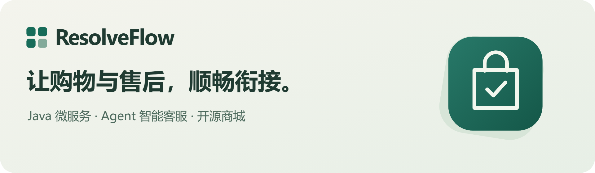
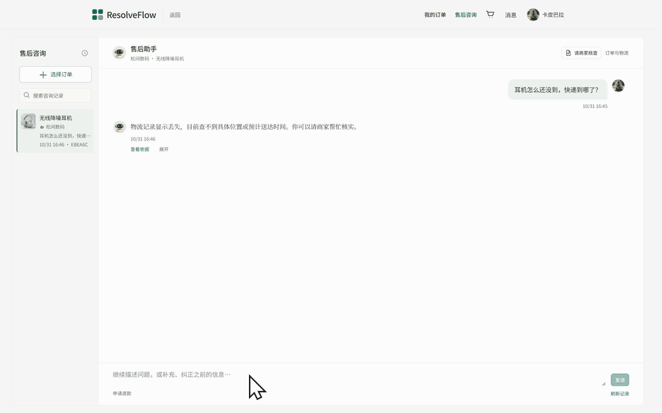
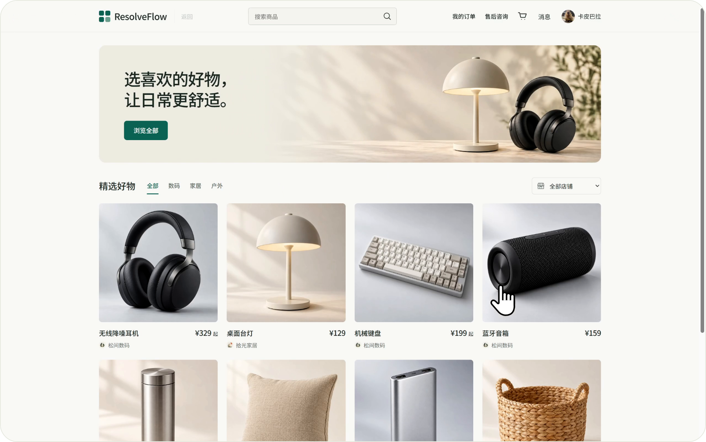
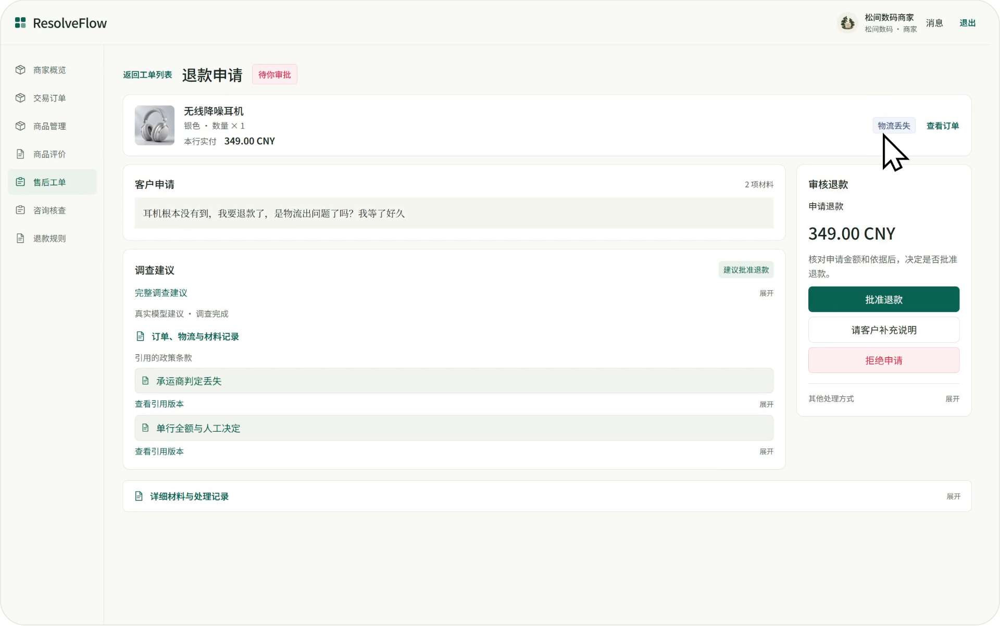
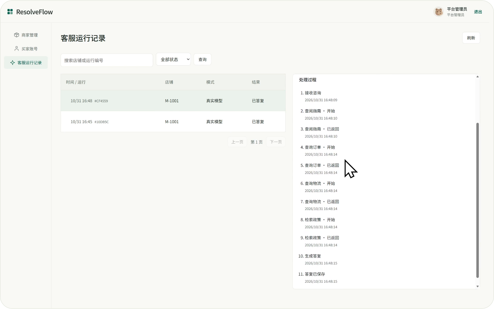
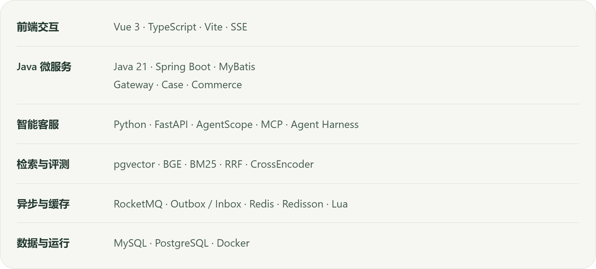
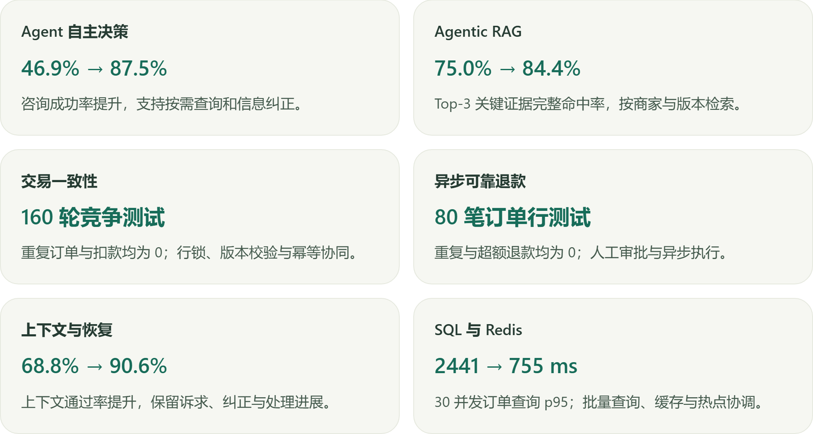

<p align="center">
  
</p>

## 完整演示

https://github.com/user-attachments/assets/34304069-e2da-4552-ac25-2443e1b759d3

## 关键流程



## 三端体验



<p align="center">买家</p>



<p align="center">商家</p>



<p align="center">平台</p>

## 技术栈

<picture>
  <source media="(max-width: 600px)" srcset="docs/assets/readme/tech-stack-mobile.png">
  
</picture>

## 微服务架构


## 核心设计

<picture>
  <source media="(max-width: 600px)" srcset="docs/assets/readme/core-design-mobile.png">
  
</picture>

## 快速开始

```powershell
$env:RESOLVEFLOW_MODEL_API_KEY = '你的模型密钥'
.\start.ps1
```

<p align="center">
  <a href="docs/local-runtime.md">运行指南</a> ·
  <a href="docs/system-design.md">系统设计</a> ·
  <a href="docs/evaluation-results.md">评测结果</a>
</p>
