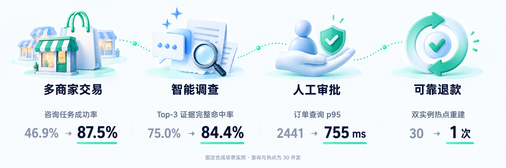
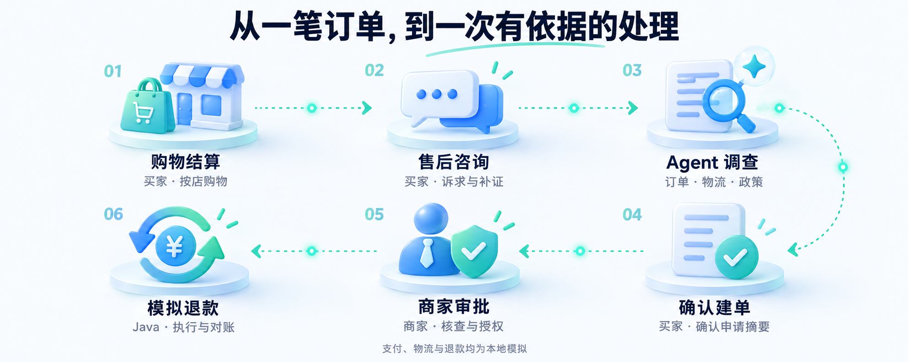
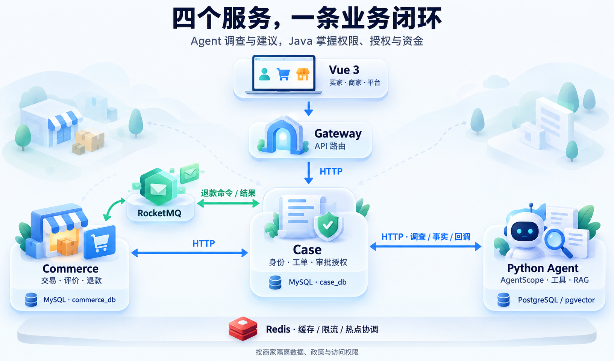

<p align="center">
  
</p>

<p align="center">
  
  
</p>

<p align="center">跨店购物，按需调查，人工审批，可靠执行。<br>从用户的一句咨询，到一笔有依据、可追踪的退款。</p>

<p align="center">
  
</p>

**买家**跨店购物、咨询与补证；**商家**核查依据、审批申请、管理本店订单；**平台**管理账号。商品评价、商家回复和售后进度在同一系统中衔接。

<p align="center">
  
</p>

## 六个值得深入的设计

**🧠 Agent 自主决策**　基于 AgentScope 按需选择订单、物流与政策工具，支持信息纠正和咨询建单。较固定分支 Workflow，咨询任务成功率 **46.9% → 87.5%**，平均首正文 **3.37 秒**。

**🔎 Agentic RAG 政策检索**　按商家与版本检索依据，构建并评测 BGE + BM25、RRF 和 CrossEncoder 方案。Top-3 关键证据完整命中率 **75.0% → 84.4%**，本地热态约 **135 ms**。

**🛒 多商家交易与并发一致性**　按店结算，版本校验、行锁与付款幂等协同，订单和账本同事务生成。10 / 30 并发、8 类 **160 轮**测试中，重复订单与重复模拟扣款均为 **0**。

**🛡️ 版本化授权与异步可靠退款**　补证使旧授权失效，RocketMQ + Outbox / Inbox 保障消息处理，预留金额并沿用原操作对账。**80 笔**订单行模拟退款中，重复与超额退款均为 **0**。

**🧩 Agent Harness 与上下文管理**　保留诉求、纠正与未完成事项，约束调用预算和工具权限，复用已保存结果恢复。上下文通过率 **68.8% → 90.6%**；结果已保存的中断对照中，恢复后新增模型请求 **减少 50%**。

**⚡ SQL 与 Redis 优化**　批量查询订单，缓存审核队列和评价，结合 Redisson 热点协调、Lua 限流与有界回源。30 并发下查询成功请求 p95 **2441 → 755 ms**，每请求 SQL **减少 91.4%**；双实例热点重建 **30 → 1 次**。

<details>
<summary>查看实测条件</summary>

- 咨询：32 个合成场景；首正文为服务端平均值。
- 检索：自建政策集；精排数据对应检索评测方案，当前运行配置见政策说明。
- 交易：160 轮竞争场景；退款：80 个订单行、70 个订单。
- 上下文：16 段对话 × 2 个检查点；恢复降幅取结果已保存且双方正确的 9 对，新增请求 26 → 13。
- 查询：30 秒预热、60 秒采样，3 轮中位数；热点：两个 Commerce 实例各 15 请求，同 key 冷缓存突发，3 轮中位数。

以上均为固定合成场景、本地环境与模拟资金的独立实测。完整条件、失败与当前回归情况见下方文档入口。

</details>

## 在本地体验

先按运行指南安装依赖、下载政策模型并初始化演示环境，然后在 **Windows PowerShell** 中启动：

```powershell
$env:RESOLVEFLOW_MODEL_API_KEY = '你的模型密钥'
.\start.ps1
```

浏览器打开 `127.0.0.1:5174/#/shop`，买家 `buyer01`、商家 `admin01`、平台 `platform`，本机初始口令 `123456`。

<details>
<summary>环境与日常命令</summary>

Docker Desktop（Linux containers）、JDK 21、Python 3.12 / uv、Node 22 / pnpm 12.4.1。完整商城使用 Windows 启动入口，Linux CI 使用构建与核心 API 冒烟入口。

```powershell
.\status.ps1
.\stop.ps1
```

新咨询与调查会调用模型，产生提供方费用；密钥只在本机配置。支付、物流和退款均为本地模拟，退款经人工最终审批，按单订单行全量执行。

</details>

<p align="center">
  <a href="docs/local-runtime.md"></a>
  <a href="docs/system-design.md"></a>
  <a href="docs/evaluation-results.md"></a>
</p>
