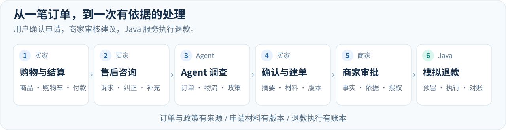

<p align="center">
  
</p>

<p align="center">
  <strong>多商家交易 × 智能调查 × 人工审批 × 可靠退款</strong>
</p>

<p align="center">
  <code>Java 21</code> · <code>Spring Boot</code> · <code>AgentScope</code> · <code>Vue 3</code> · <code>Docker</code>
</p>

<p align="center">
  <a href="#业务体验">业务体验</a> ·
  <a href="#系统架构">系统架构</a> ·
  <a href="#核心技术">核心技术</a> ·
  <a href="#实测结果">实测结果</a> ·
  <a href="#快速开始">快速开始</a>
</p>

ResolveFlow 是一个基于微服务与 Agent 的电商智能售后个人项目。买家可以跨店购物、结算并发起售后；Agent 根据诉求查询订单、调查物流、检索政策、追问必要材料并生成建议；商家审核后，由 Java 服务完成退款执行与结果对账。

**从用户的一句咨询，到一笔有授权、有记录、可追踪的退款。** 数据、政策和访问权限按商家隔离，购物、申请、调查、审批与执行连接在同一条业务链路中。

| 咨询任务成功率 | Top-3 关键证据完整命中率 | 订单查询成功请求 p95 | 双实例热点缓存重建 |
| :---: | :---: | :---: | :---: |
| 46.9% → **87.5%** | 75.0% → **84.4%** | 2441 → **755 ms** | 30 → **1 次** |

<p align="center"><sub>固定合成场景实测；查询与热点为 30 并发，热点使用两个 Commerce 实例。各项独立评测，完整条件见下方实测结果。</sub></p>

## 业务体验



| 角色 | 可以完成什么 |
| --- | --- |
| **买家** | 浏览商品、按店购物车、多商品结算与模拟付款；查询本人订单，咨询 Agent、确认售后摘要、补充材料并查看进度；签收后评价。 |
| **商家** | 管理本店商品与订单、模拟发货；核查咨询、查看调查依据、审核退款申请，并回复商品评价。 |
| **平台** | 管理买家与商家账号；售后审批由对应商家处理。 |

咨询过程中可以纠正信息、补充材料，或者提交独立人工核查。退款申请先生成可编辑摘要，买家确认后再建单；Agent 的调查建议进入商家工作台，与订单事实、政策依据和处理进度一起展示。

## 系统架构


| 组件 | 主要职责 | 数据与协作 |
| --- | --- | --- |
| **Gateway** | 公共 API 路由 | 将请求转发到 Case，业务鉴权由 Case 执行。 |
| **Case** | 身份与店铺绑定、咨询与工单、材料版本、审批授权 | MySQL `case_db`；调用 Commerce / Agent，发布退款命令并接收结果。 |
| **Commerce** | 商品、购物车、结算、订单、评价、退款资金与对账 | MySQL `commerce_db`；通过 RocketMQ 消费命令、发布结果。 |
| **Python Agent** | AgentScope 主循环、工具调用、政策检索、上下文与恢复 | PostgreSQL / pgvector；持久化运行与调用记录，通过受限入口读取业务事实。 |

Redis 承担工作台与评价缓存、账号限流和热点重建协调。**Java 掌握业务权限、审批授权和资金，Agent 负责调查与建议。**

技术栈：Java / Spring Boot / Spring Cloud Gateway / MyBatis / MySQL / Redis / Redisson / RocketMQ；Python / FastAPI / AgentScope / MCP / PostgreSQL / pgvector；Vue 3 / TypeScript / Docker。

## 核心技术

### 01 · Agent 自主决策

基于 AgentScope 构建多轮售后 Agent，根据当前诉求和工具返回选择下一步，动态查询订单、物流与政策。支持信息纠正，以及“咨询 → 摘要确认 → 售后建单”闭环；流式回答与调查进度让用户看到处理过程。

[多轮调查与决策](agent/src/resolveflow/support/orchestration.py) · [会话运行](agent/src/resolveflow/support/service.py) · [AgentScope 适配](agent/src/resolveflow/harness/sdk_adapter.py)

### 02 · Agentic RAG 政策检索

将政策检索封装为 Agent 工具，按用户诉求查询售后依据，并固定商家与政策版本。构建并评测 BGE 向量与 BM25 混合召回、RRF 融合和 CrossEncoder 精排方案；回答保留来源与版本，供用户和商家核对。精排指标对应评测方案，线上检索配置见[政策检索说明](docs/policy-rag.md)。

[受限政策工具](agent/src/resolveflow/support/sources.py) · [候选融合](agent/src/resolveflow/support/retrieval.py) · [政策索引](agent/src/resolveflow/policies/index.py)

### 03 · 多商家交易与并发一致性

实现按店购物车与多商品结算，通过版本校验、行锁和付款幂等处理并发请求。订单与账本同事务生成；付款响应丢失后可以查询原结果，避免另起一次扣款。买家可跨店购物，商家查询与写入始终限定本店范围。

[多商品结算](java/commerce-service/src/main/java/com/resolveflow/commerce/catalog/MultiCheckoutService.java) · [付款与幂等](java/commerce-service/src/main/java/com/resolveflow/commerce/catalog/CheckoutPayments.java) · [付款恢复](java/commerce-service/src/main/java/com/resolveflow/commerce/catalog/CheckoutRecoveryService.java)

### 04 · 版本化授权与异步可靠退款

审批授权绑定材料版本，补证后旧授权自动失效，授权消费后冻结执行输入。RocketMQ、Outbox / Inbox 和操作幂等共同处理重复消息与服务中断；金额预留防止超退，结果未知时保留占用，沿用原操作 ID 对账。

[授权与版本](java/case-service/src/main/java/com/resolveflow/caseservice/casefile/AuthorizationService.java) · [命令 Outbox](java/case-service/src/main/java/com/resolveflow/caseservice/outbox) · [消息消费](java/commerce-service/src/main/java/com/resolveflow/commerce/messaging/RefundCommandConsumer.java) · [退款与对账](java/commerce-service/src/main/java/com/resolveflow/commerce/refund)

### 05 · Agent Harness 与上下文管理

记录用户诉求、信息纠正和未完成事项，按需保留、读取历史，减少遗忘与重复追问。Harness 控制模型调用次数、工具权限并校验回答依据；运行与回调受 fence 保护，中断后可复用已保存结果，继续原有预算与执行上下文。

[上下文构建](agent/src/resolveflow/support/context.py) · [对话记忆](agent/src/resolveflow/support/memory.py) · [恢复](agent/src/resolveflow/support/recovery.py) · [Harness](agent/src/resolveflow/harness)

### 06 · SQL 查询与 Redis 缓存优化

通过按页批量查询减少订单列表的逐条读取；Redis 缓存审核队列与商品评价，评价缓存绑定数据库 epoch。Redisson 协调热点重建，锁内二次检查；Lua 账号限流与有界回源控制数据库压力，资金一致性仍由 MySQL 事务保障。

[订单分页](java/commerce-service/src/main/java/com/resolveflow/commerce/catalog/PurchasePageReader.java) · [评价缓存](java/commerce-service/src/main/java/com/resolveflow/commerce/catalog/ProductReviewReadCache.java) · [热点锁](java/commerce-service/src/main/java/com/resolveflow/commerce/catalog/ReviewRebuildLock.java) · [审核队列缓存](java/case-service/src/main/java/com/resolveflow/caseservice/casefile/RedisReviewQueueCache.java)

## 实测结果

| 方向 | 对照结果 | 测试条件 |
| --- | --- | --- |
| **Agent 咨询** | 任务成功率 **46.9% → 87.5%**；平均首正文 **3.37 秒** | 32 个模拟咨询场景，与固定分支 Workflow 对照；首正文为服务端平均值。 |
| **政策检索** | Top-3 关键证据完整命中率 **75.0% → 84.4%**；热态平均约 **135 ms** | 自建售后政策评测集，与纯向量检索对照，结果属于检索评测方案。 |
| **交易并发** | 重复订单、重复模拟扣款均 **0 笔** | 10 / 30 并发、8 类共 160 轮交易竞争测试。 |
| **异步退款** | 重复退款、超额退款均 **0 笔** | 80 笔订单行模拟退款，覆盖 70 个订单。 |
| **上下文管理** | 处理通过率 **68.8% → 90.6%** | 与直接拼接聊天历史对照，16 段对话 × 2 个检查点，每组 32 项。 |
| **保存结果恢复** | 恢复后新增模型请求 **减少 50%** | 结果已保存且双方正确的 9 对中断对照，新增请求 26 → 13。 |
| **订单查询** | 成功请求 p95 **2441 → 755 ms**；每请求 SQL **减少 91.4%** | 30 并发，30 秒预热 + 60 秒采样，3 轮中位数。 |
| **双实例热点** | 评价缓存重建 **30 → 1 次** | 两个 Commerce 实例各 15 请求，同 key 冷缓存突发，3 轮中位数。 |

以上为固定合成输入、本地环境和模拟资金的独立实测。样本、对照条件和结果边界见[评测说明](docs/evaluation-results.md)，构建与回归情况见[开发验证](docs/development.md)。

## 快速开始

完整商城使用 **Windows PowerShell** 启动。需要 Docker Desktop（Linux containers）、JDK 21、Python 3.12 / uv、Node 22 / pnpm 12.4.1，以及模型 API 密钥。

1. 获取代码：

   ```powershell
   git clone --depth 1 https://github.com/Capybara0618/ResolveFlow.git
   cd ResolveFlow
   ```

2. 按[本机运行](docs/local-runtime.md)完成依赖安装、政策模型下载和首次演示环境初始化。
3. 已完成初始化后，设置密钥并启动：

   ```powershell
   $env:RESOLVEFLOW_MODEL_API_KEY = '你的模型密钥'
   .\start.ps1
   ```

   密钥仅在本机配置。新咨询与调查会调用模型并产生提供方费用。

| 入口 | 地址 / 账号 |
| --- | --- |
| **买家商城** | <http://127.0.0.1:5174/#/shop> |
| **Gateway** | <http://127.0.0.1:8180> |
| **买家** | `buyer01`–`buyer10` |
| **商家** | `admin01`–`admin03` |
| **平台** | `platform` |
| **本机演示初始口令** | `123456` |

```powershell
.\status.ps1  # 查看运行状态
.\stop.ps1    # 停止所属服务并保留数据
```

支付、物流与退款均为本地模拟。项目只执行单订单行全量退款，人工最终审批；完整本机商城入口目前为 Windows，Linux CI 使用构建与核心 API 冒烟入口。

## 深入了解

| 你想了解什么 | 入口 |
| --- | --- |
| 安装、初始化、启停与账号 | [本机运行](docs/local-runtime.md) |
| 服务职责、数据归属与一致性约束 | [系统设计](docs/system-design.md) |
| 测试、构建与当前验证结果 | [开发验证](docs/development.md) |
| 指标分母、对照条件与限制 | [评测说明](docs/evaluation-results.md) |
| API、事件与跨语言协议 | [核心契约](contracts/core) |
| 目录与公开文件边界 | [仓库说明](docs/repository.md) |

Java 服务位于 [`java/`](java)，Agent 位于 [`agent/`](agent)，前端位于 [`web/`](web)，基础设施位于 [`infra/`](infra)。
