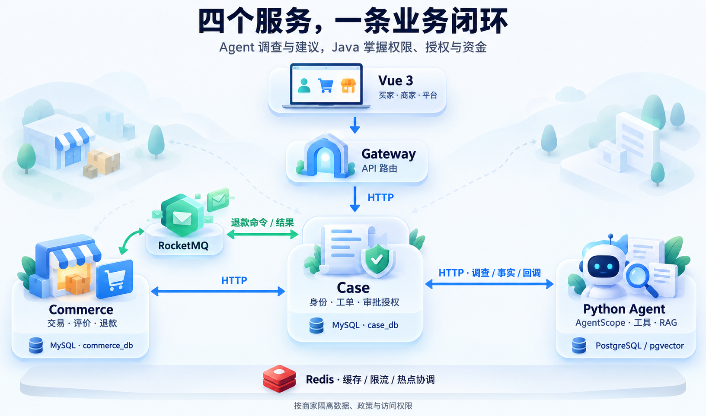

# ResolveFlow

**从选购商品到售后退款，一站走完。**

一个多商家商城与智能售后项目。买家选购商品、咨询订单问题并确认申请，Agent 查询订单、物流和店铺政策，帮助买家整理诉求；商家查看依据、核验审批，处理结果回到买家的原会话。

Vue 3 · Java 21 / Spring Boot · AgentScope · MySQL · PostgreSQL / pgvector · Redis · RocketMQ

## 看一次完整体验

> **动图位置｜约28秒**
>
> 商品选择 → 自然语言咨询 → 查询与回复 → 买家核对申请 → 商家审批 → 模拟退款完成。
>
> **视频位置｜约3分40秒** 跟着同一笔订单，看看买家、Agent 和商家如何一起完成售后。

“耳机还没收到，帮我看看。”像平时找客服一样描述问题，接下来每一步都有清楚的入口：

1. **先弄清问题。** 助手查询这件商品的订单与物流，告诉买家查到了什么。
2. **由买家确认诉求。** 核对商品、金额和退款原因，编辑好再确认提交。
3. **把处理依据交给商家。** 商家查看客户材料、政策原文及调查建议，先核验，再决定是否批准。
4. **随时查看处理结果。** 回到原会话，就能看到进展、退款金额和下一步。

## 买家用着顺手，商家处理清楚

| 视角 | 可以做什么 | 代表素材 |
| --- | --- | --- |
| 买家 | 浏览与购买、咨询订单、核对售后申请、查看结果 | 素材 C：聊天与待确认退款卡，待录制 |
| 商家 | 管理本店商品和订单、回复核查、核验材料并审批售后 | 素材 D：当前工单的依据与处理区，待录制 |
| 平台 | 管理店铺及买家账号、查看脱敏客服运行记录 | 素材 E：同次咨询的运行详情，待录制 |

## 这些体验是怎么做出来的

**助手根据问题选择要查的资料。** AgentScope 驱动模型查询订单、物流和政策，结合多轮对话中的补充与纠正继续处理。买家确认申请后，商家在工作台核验审批。

**每条政策都能找到出处。** 政策按店铺和版本管理，调查建议关联读到的原文，商家可以直接查看依据。

**申请、核验、审批，步骤清楚。** 买家核对诉求，商家核验材料并审批。补充材料后，系统更新申请版本与授权，商家依据当前信息继续处理。

**金额、订单和退款由 Java 服务管理。** 按店铺结算，金额与版本由 Java 校验；Outbox / Inbox、幂等操作和资金预留连接异步模拟退款。结果待确认时继续跟踪原操作。

**对话能延续，运行能追踪。** 上下文保留关键事实、纠正和未完成事项；保存的模型结果可以在恢复流程中复用。平台查看脱敏运行过程，买家看到面向自己的答复和处理结果。

**性能优化有测试记录。** 订单批量查询、Redis 缓存和热点协调都有对应实现与测量，源码与验证入口一起提供。

### 实测结果

| 范围 | 结果 | 条件 |
| --- | --- | --- |
| 咨询任务成功率 | 46.9% → 87.5% | 32 个固定合成场景，与固定分支 Workflow 对照 |
| Top-3 关键证据完整命中率 | 75.0% → 84.4% | 自建政策集，检索方案对照评测 |
| 交易并发 | 重复订单与重复模拟扣款均为 0 | 10 / 30 并发、8 类、160 轮竞争测试 |
| 模拟退款 | 重复与超额退款均为 0 | 80 个订单行、70 个订单的测试样本 |
| 订单查询成功请求 p95 | 2441 → 755 ms | 30 并发，3 轮中位数 |

测试数据、方案配置与完整结果见[评测说明](docs/evaluation-results.md)。

## 自己体验一下

**首次配置：** 按[运行指南](docs/local-runtime.md)安装依赖、下载固定版本的政策检索模型，并初始化新的演示环境。已有数据的环境直接按日常启动流程操作。

**日常启动：** 在 Windows PowerShell 中设置模型密钥并启动：

```powershell
$env:RESOLVEFLOW_MODEL_API_KEY = '你的模型密钥'
.\start.ps1
```

打开 [商城](http://127.0.0.1:5174/#/shop)。默认演示账号如下，初始密码均为 `123456`：

| 角色 | 账号 | 建议体验 |
| --- | --- | --- |
| 买家 | `buyer01` | 购买松间数码商品，从订单进入咨询 |
| 松间数码商家 | `admin01` | 查看本店订单、咨询核查及售后申请 |
| 平台管理员 | `platform` | 查看店铺、买家账号和脱敏运行记录 |

可以先购买一件商品并问助手“帮我看看这件商品的订单情况”。要复现视频中的丢件退款，需要在商家模拟发货后，通过项目提供的[物流模拟器](scripts/logistics_simulator.py)追加丢失事件，再咨询、确认申请并完成商家核验。

<details>
<summary>运行环境与常用命令</summary>

完整商城启动入口支持 Windows PowerShell；需要 Docker Desktop（Linux containers）、JDK 21、Python 3.12 / uv、Node 22 / pnpm 12.4.1。Linux CI 的构建与核心 API 检查入口见开发验证文档。

```powershell
.\status.ps1
.\stop.ps1
```

演示接入真实模型，支付、物流和退款使用模拟服务；商品数据与图片为合成素材。模型调用按提供方计费。

</details>

## 架构与源码



Gateway 提供统一入口，Case 管理咨询、工单和授权，Commerce 管理交易、账本与退款，Python Agent 负责模型运行和政策查询。服务之间如何配合，见[系统设计](docs/system-design.md)。

| 想了解什么 | 入口 |
| --- | --- |
| 安装、启动与演示账号 | [运行指南](docs/local-runtime.md) |
| 服务边界与通信 | [系统设计](docs/system-design.md) |
| 实测数据与测试条件 | [评测说明](docs/evaluation-results.md) |
| 当前构建与验证入口 | [开发验证](docs/development.md) |
| 项目文件怎么组织 | [仓库导览](docs/repository.md) |
