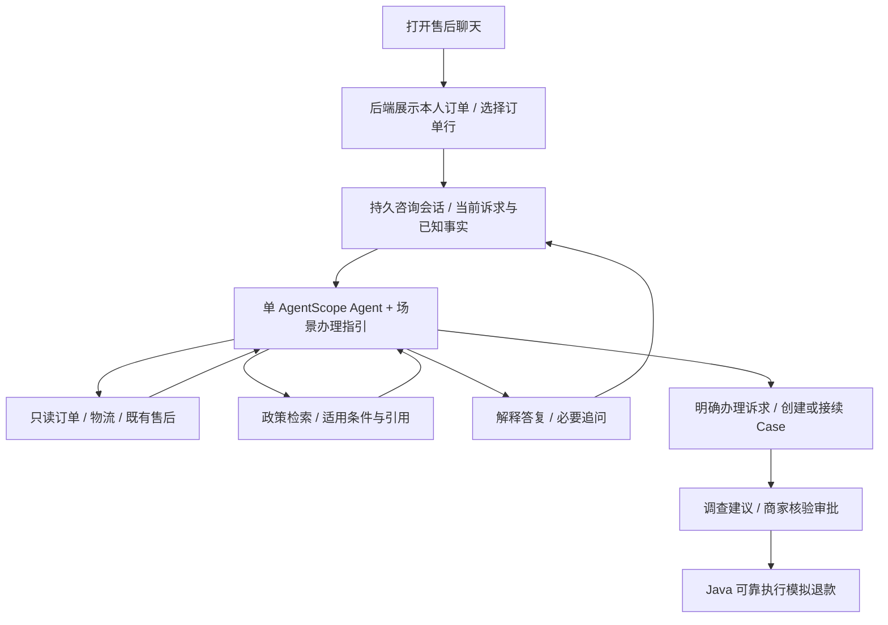

# 客服 Agent 工程搭建调研与 ResolveFlow 对照

调研日期：2026-10-09。补充[上一轮资料调研](customer-agent-research.md)，本轮重点是实际客服产品的搭建方式及公开源码。商业产品公开文档只用于确认产品行为与配置方式，不推断其私有推理架构；源码阅读不等于本机部署或效果验证。实施进度仅维护在 [todo 顶部](../tasks/todo.md)。

## 1. 工程结论

最值得借鉴的是把持续会话、业务办理指引、知识检索、实时业务工具和人工接续组合起来。业务指引说明目标、必需事实和完成条件；Agent 根据客户表达及工具结果选择补问、检索或回答。自然语言入口与稳定业务规则可以共存。

ResolveFlow 已有订单/物流事实、政策检索、调查 run、补证/revision、人工审批及可靠模拟退款。重构重点建议放在这些能力之前的客服会话及办理体验，继续沿用 AgentScope 2.0.8 唯一循环、Java 权威业务状态和现有依赖锁。本文是设计建议，未冻结新协议、界面或实施任务。

## 2. Intercom Fin：实际客服流程如何搭建

阅读其官方 [Procedures 说明](https://www.intercom.com/help/en/articles/12495167-fin-procedures-explained)、[搭建教程](https://www.intercom.com/help/en/articles/12599391-quick-start-create-a-fin-procedure)、[Procedures/Workflows 对比](https://www.intercom.com/help/en/articles/14077835-procedures-vs-tasks-vs-workflows)及 [API 接入指南](https://www.intercom.com/help/en/articles/10576235-designing-and-using-your-apis-with-data-connectors)。

公开配置把知识问答、自然语言办理指引、实时 API 和固定路由分别组织：简单 FAQ 使用知识库；多步骤业务通过 Procedure 描述；订单等当前状态通过连接器读取；菜单及分流可用 Workflow。Procedure 可结合条件与代码，并随会话变化调整办理过程。这里借鉴的是职责划分，不照搬其编辑器或功能数量。

搭建教程的订单查询例子包含“订单号尚未提供才询问”、查询订单及根据查询结果回答。它说明业务步骤可以明确，同时避免重复收集已有信息。定义一项办理能力时，还要写清触发/不触发条件、可用工具和结束方式，并用完整模拟对话检验。

API 指南另有很贴近用户入口决定的建议：根据可信身份提供可选记录，让客户选择，减少手输业务 ID；API 返回任务所需字段。对 ResolveFlow 的直接建议是“本人订单列表 → 选择订单行 → 自然咨询”，订单列表由后端读取，模型无需先猜订单。

该产品公开说明 Procedures 的动作按顺序执行，不能据此宣称并行调查是成熟客服的必需能力。其多轮 Simulations 值得借鉴；我们应使用自定任务完成条件，不照搬商业计费口径中的解决率。

## 3. Chatwoot Captain：从公开代码学习实际会话工程

源码快照：`chatwoot/chatwoot` 的 `develop`，revision `807e9ed67ad00048d47c878c1945349391172b6b`。以下链接固定到该 revision。Captain 所读实现位于 `enterprise/`；[社区版本说明](https://www.chatwoot.com/community)将 Captain AI 列为付费能力，不能把公开源码等同于免费完整产品。

| 阅读入口 | 确认到的实现 | 对本项目的启发 |
| --- | --- | --- |
| [Widget 消息控制器](https://github.com/chatwoot/chatwoot/blob/807e9ed67ad00048d47c878c1945349391172b6b/app/controllers/api/v1/widget/messages_controller.rb) | 创建/找到 conversation 后保存消息；消息列表按会话读取 | 持久会话与一次调查 run 分开；查询政策无需先有退款工单 |
| [响应调度器](https://github.com/chatwoot/chatwoot/blob/807e9ed67ad00048d47c878c1945349391172b6b/enterprise/app/services/captain/conversation/response_scheduler_service.rb) | 后台 job 带上触发消息 ID；近期附件可短暂等待聚合 | 每次回复绑定输入版本；附件聚合只是参考，本轮不新增图片识别 |
| [响应后台任务](https://github.com/chatwoot/chatwoot/blob/807e9ed67ad00048d47c878c1945349391172b6b/enterprise/app/jobs/captain/conversation/response_builder_job.rb) | 构建历史、运行 Agent、生成前后检查新客户消息；回复创建使用局部事务，模型调用在事务外 | 连续补充/纠正时避免投递过时回复；会话响应版本与已有 run fence 分别负责不同层面 |
| [Agent Runner](https://github.com/chatwoot/chatwoot/blob/807e9ed67ad00048d47c878c1945349391172b6b/enterprise/app/services/captain/assistant/agent_runner_service.rb) | 组织 history、最新输入及运行 context，当前 `max_turns: 10` | 会话历史、当前任务和工具结果应明确组织；不因其 scenario agent 机制给本项目增加多 Agent |
| [FAQ 工具](https://github.com/chatwoot/chatwoot/blob/807e9ed67ad00048d47c878c1945349391172b6b/enterprise/lib/captain/tools/faq_lookup_tool.rb) | 只搜 assistant 下已批准 FAQ，记录检索来源及可用引用 | 知识的审核状态、归属和回答出处同样值得展示；该工具本身不能证明混合检索效果 |
| [HTTP 工具](https://github.com/chatwoot/chatwoot/blob/807e9ed67ad00048d47c878c1945349391172b6b/enterprise/lib/captain/tools/http_tool.rb) | 由配置生成请求/响应；GET 可用于辅助回复，区分查询与会改变业务的动作 | 工具描述要告诉模型何时调用、参数含义及结果含义；继续保留我们自己的只读工具权限 |
| [转人工工具](https://github.com/chatwoot/chatwoot/blob/807e9ed67ad00048d47c878c1945349391172b6b/enterprise/lib/captain/tools/handoff_tool.rb) | 原因及分类、内部说明、会话状态变更，执行时检查消息是否已过时 | 转人工是所有权/状态变更和信息交接，不是单发一句“请联系客服” |
| [回复构建](https://github.com/chatwoot/chatwoot/blob/807e9ed67ad00048d47c878c1945349391172b6b/enterprise/app/jobs/captain/conversation/message_builder.rb) | 通过 response parts 和可信引用生成客户可见内容，再持久化 outgoing message | 客户说明与后台结构化建议可以共享事实，但应有各自展示格式 |

以上确认的是这些模块的行为，没有把整个事件注册/调度链、部署配置及收费策略全部实测。另读的 `CaptainListener` 处理满意度/结束事件，不能误写成客户新消息的生产调度入口。

工程阅读中最值得优先吸收的是“新消息使旧回复失效”。例如用户先说没收到，随后补充“邻居刚送来了，只是商品损坏”，模型旧任务即使已产生答案，也不能继续按未收货问题回复。我们的会话层需要定义这个行为，已有工单 revision/run STALE 可复用，但咨询阶段目前仍需新的衔接设计。

## 4. Dify：会话、一次执行和流式事件如何分开

源码快照：`langgenius/dify` 的 `main`，revision `f9241b59fe4ffd4da90fd18e2fc827227e6edb15`。

- [Chat API](https://github.com/langgenius/dify/blob/f9241b59fe4ffd4da90fd18e2fc827227e6edb15/api/controllers/service_api/app/completion.py)接收 `conversation_id`，区分 blocking/streaming，已有会话按应用和终端用户核验。
- [生成入口](https://github.com/langgenius/dify/blob/f9241b59fe4ffd4da90fd18e2fc827227e6edb15/api/services/app_generate_service.py)按应用模式分派。AgentChat 与 AdvancedChat 是不同路径，不能把某一路径描述成所有 Dify 应用的统一实现。
- [AgentChat Runner](https://github.com/langgenius/dify/blob/f9241b59fe4ffd4da90fd18e2fc827227e6edb15/api/core/app/apps/agent_chat/app_runner.py)从会话构建记忆、组织输入并选择工具调用策略；多步模型/工具 I/O 前提交并释放设置阶段的数据库 session。
- [会话变量更新](https://github.com/langgenius/dify/blob/f9241b59fe4ffd4da90fd18e2fc827227e6edb15/api/services/conversation_variable_updater.py)按会话保存变量；[AdvancedChat 消息流水线](https://github.com/langgenius/dify/blob/f9241b59fe4ffd4da90fd18e2fc827227e6edb15/api/core/app/apps/advanced_chat/generate_task_pipeline.py)记录答案、用量、响应延迟及流式首 token 时间。

对 ResolveFlow 的建议是把会话长期事实、当前 turn 输入及调查执行状态区分开；展示“正在查物流”等简洁进度，最终回复另行保存；区分首个可见反馈与完整回复耗时。会话记忆/流式接口不能替代现有受 fence 保护的领域恢复。Dify 是通用应用平台，这次不引入其平台或重新选择框架。

## 5. 对当前项目的具体改动判断

下面是基于工程调研和当前 [核心范围](core-scope.md)、[Agent 规格](agent-spec.md)、[Harness](agent-harness.md)的项目建议，不是上述产品的私有架构事实。

| 层次 | 当前可复用 | 待设计的增量 |
| --- | --- | --- |
| 入口与会话 | 本人订单、具体订单行、已有售后/商家界面 | 聊天窗口、订单选择、持续消息、咨询与办理意图 |
| Agent | AgentScope 2.0.8、五个 MCP、调用记录/预算、提问及建议 | 按场景编写办理指引，支持插问/纠正，咨询阶段工具衔接 |
| RAG | 商家/版本过滤、原文条款、来源及引用 | 结合当前主题和订单生成检索问题，按回答需要组织条件/例外；算法是否变化仍看测量 |
| Case | 工单、材料、revision、人工审批及轨迹 | 明确何时创建/接续工单，把咨询事实映射为客户陈述，关联会话与正式案件 |
| Commerce | 订单/物流查询、行级资格、可靠模拟退款 | 为未创建案件的本人咨询定义只读访问契约，不伪造 case/run 身份 |
| Redis/执行恢复 | 非权威缓存、既有 PG 调用账/checkpoint/fence | 会话缓存需求确定后再讨论；消息事实、审批和资金不依赖缓存作为唯一记录 |

建议的关系图：

会话、工单和 run 的关系与存储位置尚未冻结，图不要求新增微服务。转人工优先接现有商家工作台，交接诉求、已查事实、政策依据及剩余问题。咨询阶段的政策回答应作为咨询能力设计，不把调查 run 的 COMPLETED 偷换成客服问题已解决。

## 6. 自主 Agent 的价值假设应怎么改

建议从“自由探索比固定流程更强”改为“相同办理规则下，更好适应客户表达及信息变化”。基线沿用用户选择的固定调查流程，提供合理分支和基本对话修复，和动态 Agent 共享模型、政策库及工具事实。

| 行为与数据设计 | 可测指标 | 预期与判定 |
| --- | --- | --- |
| 同一业务事实：一次给全信息、分轮给、先插问后补充 | 任务完成率、重复询问次数、客户需答轮次 | 希望 Agent 利用已有信息降低不必要追问；信息充分且顺序稳定的场景不预设 Agent 优势 |
| 同一任务：中途纠正签收/损坏描述、改选订单行 | 纠正后关键事实正确率、过时回复次数 | 应切换到当前事实与对象；不能只在内部摘要变更而客户答复仍错误 |
| 政策解释 + 当前订单事实组合 | 关键条件/例外覆盖、业务事实正确率、引用支撑率 | 先确认问题所需依据，再测检索/回答；Recall 的改善不直接等于客服完成率改善 |
| 已有工单进度咨询、确需商家核验的争议 | 结果解释正确率、交接必要信息完整度 | 合理接续/转交也可完成该类任务，不把所有转人工算失败 |
| 全场景 | 完整回复 p50/p95、模型请求/token、业务读取次数 | 同时报告成本及耗时；“正在查询”的即时提示不计为完整业务答复 |

数据构造要交叉变化业务状态、信息提供方式和客户意图，开发例与保留评测例分开。合成样例证明的是受控行为，具体提升幅度仍要真实运行确定；目前不改旧实验数字、Gold 或简历。

## 7. 下一份设计产物

建议先写一份“已显示签收但客户未收到”的完整办理规格，再扩到其他场景：触发与不触发、目标、必需事实、工具、政策依据、允许的补问/插问/纠正、转人工交接和完成标准。对同一事实准备几种自然对话及固定流程对照；其中客户确认收到后改报损坏是单独的纠正场景。

客户选择的是订单行，签收事实由工具提供，客户否认签收作为客户陈述保留，不能让一句聊天自动变成商家已核验结论。先把这份业务规格与样例讨论清楚，再画页面状态并拆后端实现。本轮未启动任何运行服务、数据库变更、真实模型调用或框架部署。
