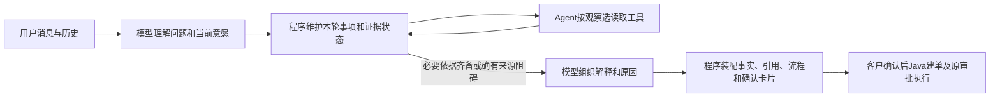

# 客服运行编排与回答职责重构

2026-10-24，用户批准从设计层修正反复出现的提前回答、重复表达和发布失败。范围为客服Python运行协议，沿用唯一AgentScope 2.0.8循环、RAG、Java资金/确认、会话和fence。进度仅tasks/todo.md顶部。旧single/staged-v1仅保留兼容和历史验证，不能将旧失败按新协议重算成功。

## 职责与阶段

新显式profile `orchestrated-v1` 复用SupportAgent和原SDK驱动，不新增模型循环或第二Agent。阶段为UNDERSTAND→INVESTIGATE→COMPOSE（含明确受阻事项）。调查中的提前收尾返回当前缺口，属于正常运行推进，不占一次格式修正；每次模型/工具/本地读仍消耗原预算/deadline，连续无进展的提前收尾有上限。真正格式/引用错误仍只修正一次，不重置预算。

## 理解和完成合同

新理解focus保留id/intent/request/needs/context_refs，增加一次性的`goal=EXPLAIN/PREPARE_REFUND/MERCHANT_REVIEW`。goal表达本轮意愿，最终回答不重复选择操作；准备退款须APPLICATION，要求人工须HANDOFF。只问流程/条件或暂缓用EXPLAIN，不能据商品或旧助手话语推断当前退款意愿。保留现有陈述提取、纠正/撤回、事件及原文锚定；不得将客户陈述升级为承运事实。

程序最低依据：当前LOGISTICS须SHIPMENT，ELIGIBILITY须POLICY，PREPARE_REFUND须ORDER；其他needs由理解/后续调查声明，不强制所有轮次读取所有工具。当前阶段先保留原REFINE_NEEDS有界追加；“模型建议的额外needs可撤回”单列后续，不为本轮通过放开撤销已承诺的事实读取。缺口表逐事项给已读合法来源、待取得来源、真实失败/可重试状态，不把未读取标为来源故障。READY只证明来源具备，不证明政策适用或生成正确。

## UI合同与证据

应用的受控指南由程序在需要流程/申请/人工操作的轮次，经原get_support_guide本地读取一次并记入原工具账/本地读预算；不消耗额外模型决策。来源的实际O编号、版本/hash进入运行上下文与最终引用。模型不再必须主动查一次指南再猜对应操作编号；来源失败不能伪造指南。订单/物流仍由Agent选工具取得，政策仍按需RAG。

`UNDERSTAND`和`INVESTIGATE`不投影候选答案；COMPOSE才开启现有流式正文投影。收尾请求不能绕过缺口，不能展示调查阶段未经就绪确认的长正文。工具顺序仍由模型按Observation选择；来源错误按原有限重试，真实不可用才允许组织带阻碍说明的回答。

## 简化回答合同

新模型动作`RESPOND`仅组织各part的task_id/text/citations和必要的语义状态/blocker；准备申请时给`refund_reason`，请求人工时可给`handoff_reason`。不输出next_steps、fact_rendering、订单金额或系统状态值。程序依据已接受goal/lifecycle、当前实际来源和conversation_state装配旧AnswerParts，选择固定操作、生成事实段和正确页面说明，最终沿原引用/金额/完成/阶段校验发布。取消/暂停/结束不生成申请摘要；受阻事项不生成看似可用的申请原因。

必要POLICY引用仍须由模型选择实际相关P编号；程序不把全库政策都自动引用以掩盖不相关答案。确定性的订单/物流事实与流程引用由程序按事项依赖补齐。root退款摘要只来自已接受PREPARE_REFUND的实际生成原因，不由模板冒充；客户编辑/确认及Java金额/资格/同行唯一申请保持。

## 持久化和兼容

新profile、提示与编排/装配源码hash进入manifest。控制状态从已保存的理解/实际工具Observation顺序重建；受控指南同样走已记账工具结果恢复。未完成旧manifest不能升级；已完成run原结果仍0调用返回。原raw/Gold/旧断言保持。新失败测试与旧模式预期分别运行，不改旧测试来把新模式伪装成旧模式兼容成功。

## 小步实施与验收

1. 实现独立控制/装配模块及状态与合同失败测试；先验证无需第二SDK循环。
2. 接入原引擎：提前收尾正常继续、程序指南、就绪后RESPOND、流式门控；所有调用继续原预算/fence。针对原几类失败做明确协议变换的离线实验，0网络/原失败不改。
3. 接API/runtime/manifest与真实临时PG、模拟SSE恢复；验证纯政策不无谓读事实、来源故障、取消/纠正、错误引用/金额、重复提前收尾终止、无新模型复用。
4. 工程通过后再固定新profile做有限真实模型确认，保存完整调用/失败；该profile先显式启用，未验证前不切日常默认。最后依据证据决定是否采用，不以模拟脚本通过替代真实模型采纳或网页整链。

本批不开发通用任务图、额外微服务、多Agent、上下文LLM压缩或新的RAG算法。预算耗尽且仍缺依据仍明确失败；不在无证据时生成“部分成功”来绕过现有Java回调合同。资料就绪后的相关性、解释质量和新意图误识别仍须真实评测。
