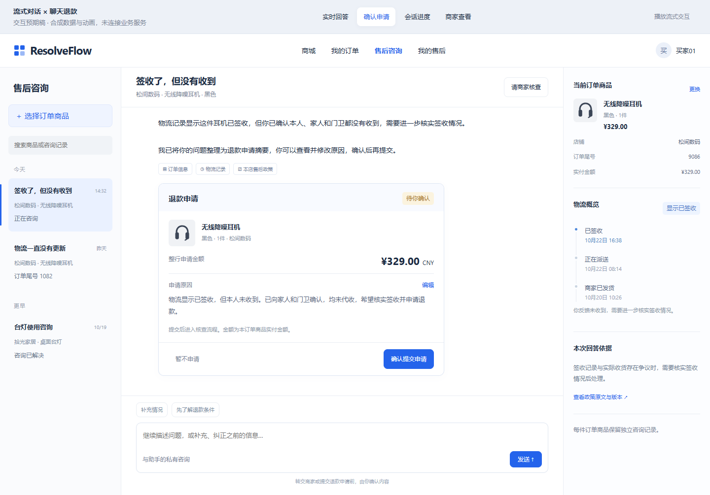
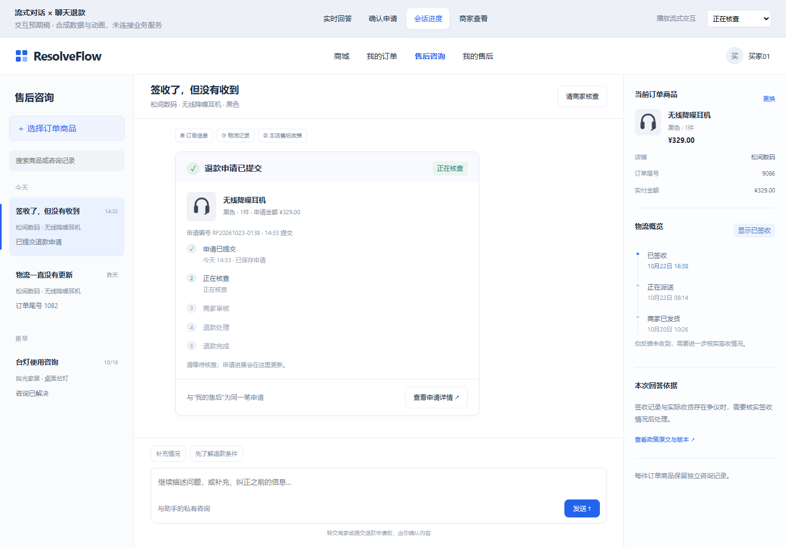

# 聊天退款闭环实施合同

2026-10-23。用户授权按“开发文档→预期图→代码”交付聊天退款闭环。本合同细化已有[产品方案](customer-chat-refund-stream-v1.md)的R1–R3；S1–S3不重做，当前进度只维护tasks/todo.md顶部。

## 产品与预期图

沿用已认可的[交互预期稿](ui-chat-refund-stream-v1/index.html#confirm)，不另起视觉方案。

卡片位于当前商品会话正文末尾：商品/规格/整行数量/权威实付、申请原因、提交范围、编辑/暂不申请/确认提交。用户可从会话退款入口主动准备，无须等模型成功。首版从当前客户原文预填原因，客户核对编辑；不把助手结论当客户陈述，不新增总结模型请求。已接纳的办理指南引导同一入口。暂不申请保存原因，重新打开可继续；取消草稿不撤销既有正式申请。

确认后同位置展示客户投影中的申请编号、状态、进度与原申请详情入口；刷新和切商品后恢复。商家沿现有售后工单处理，只收到客户确认的原因，首版不自动附带私有原文/助手来源或材料。需要补证沿原申请详情提交；人工咨询核查单独立保留。

## 状态与事务

- 草稿DRAFT/CANCELLED/CONFIRMED；EXPIRED由到期时间投影，不需要后台任务。30分钟有效；编辑递增revision，不延长到期，不改变金额/绑定/输入版本。当前会话输入版本变化后重新准备，旧草稿不能确认。
- 每会话只有一个当前草稿；重新准备可替换未确认稿，确认必须携带draft_id/revision/expected_version及请求键。旧稿ID明确冲突。已有未关闭或成功申请展示已有单；已关闭拒绝/取消后是否允许重申沿原资格判定。
- 草稿生成/确认前通过现有BuyerScopes及CustomerCaseService.line核对本人/店铺/可申请/整行实付。外部Commerce读取全部在事务外；短事务重新锁定当前账号、启用店铺、绑定、会话/草稿，检查version/revision/有效期/金额。
- 复用CaseService的准备与CaseWriter本地写入边界。草稿确认事务包含原Case创建、唯一行槽、政策绑定、调查run、原建单幂等回执、草稿case_id/确认回执；任一失败全部回滚。不能浏览器先建单再补链接，不能外部网络调用包长事务。
- 同请求键/同body返回原创建回执；同键改body返回409。已确认草稿即使会话后来更新，也可恢复同一确认回执；不同确认载荷不能伪装为同一重试。现有唯一行槽继续处理与旧申请入口的并发。冲突后读取当前申请，不另发新键自动创建。
- 进度复用CustomerCaseService.Detail，不输出审批授权、工具轨迹或私聊。RECONCILING显示结果待确认，只有CLOSED_SUCCESS显示退款完成。不修改退款执行、审批、UNKNOWN与资金约束。

## 小步与验证

1. R1：追加迁移/DTO/服务/路由，草稿读取、准备、编辑、取消；真实隔离MySQL/HTTP证明草稿不创建Case、跨买家商家不可读、版本/到期/权威金额约束。契约/fixture同步。
2. R2：CaseService拆出无写入准备，保留旧create行为；确认短事务复用CaseWriter。先失败测试覆盖同键恢复/冲突、过期/旧版本、确认关联回滚、与旧入口冲突、已有申请和不调用模型。
3. R3：独立退款卡片及客户端，挂接当前会话；保存确认未知结果的同键请求，刷新可恢复，切商品不串单；客户进度轮询独立于Agent流，商家不请求私有接口。前端交互/构建，真实页面合成HTTP检查。
4. 集中验证：相关Java/契约/前端回归；记录通过、失败和未运行。普通演示服务、真实模型、正式退款执行和简历量化分别声明，不把合成接口验收冒充真实模型效果。

不新增依赖、Agent框架、模型轮次或微服务。各验证通过小步精确commit/正常push；四个历史脏文件及旧冻结报告排除。
