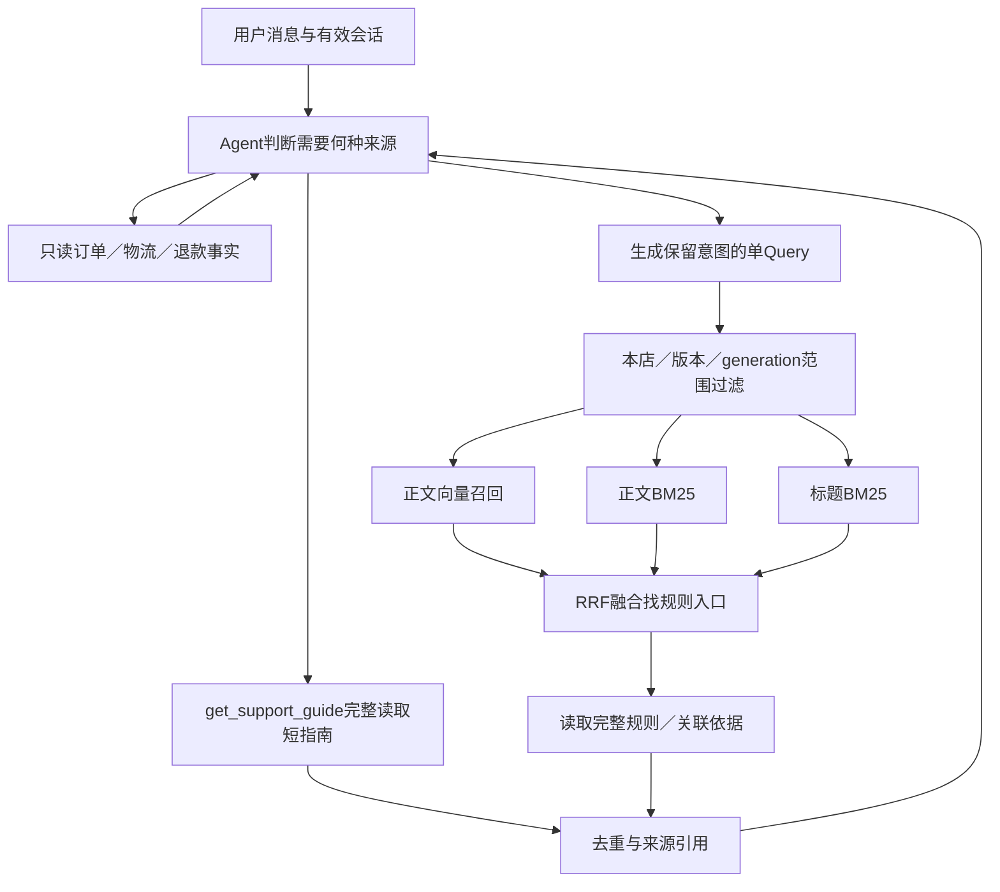

# 客服RAG架构与采用决定

2026-10-21。依据[统一实测](../reports/customer-rag-v5/README.md)确定当前采用边界，而非把所有实验组件默认部署。当前进度只看tasks/todo.md顶部。

## 知识与事实

政策资格来自Java选定的本店不可变bundle/版本；订单、物流和退款结果来自业务只读工具；咨询流程知识来自项目已实现的界面/协议。三类来源分别保留，知识检索命中不能证明某笔订单已经丢失/退款，也不能赋予Agent审批权限。

评测库16单元：6条原规则和10篇流程短文，来源/hash/类型/适用范围明确。三家当前规则正文一致，模板只计一次，政策引用映射到各自商家原文件。10篇流程现以独立版本化使用指南接入生产代码，由Agent按需完整读取；没有把16单元文件库替换成商家政策索引，原文/旧工单generation保持。接线及速度证据见[业务接入报告](../reports/customer-rag-integration-v1/README.md)。

外部四份公开原始政策、66子块继续作长文档回归；数据已多轮用于优化。其父级展开覆盖收益不直接等于商城线上质量。跨商家权限/历史版本不是靠随机负例或不同文本保证，仍由实际范围绑定和测试验证。

## 当前实现与候选路线

上图客服生产代码已实现单Query/三路/RRF/完整规则引用及按需指南读取。指南以KNOWLEDGE/O引用和版本/来源hash展示，模型读取完整正文，逐篇审计hash保留在持久记录和最终引用。流程问题无须强制检索政策，政策资格仍要求绑定本店版本。长文档父级组装和政策短引用仍是离线候选；退款调查原路径仍为dense。本批没有新增Query改写、LLM扩展或第二Agent循环；业务服务未自动启动部署。

## 规模决定路径

1. **当前极小规则库**：六条完整规则直接读取/携带必须保留为基线；16条候选知识全部短引用约1401本地tokens，整库读取约3ms，不能忽视。但给模型更多材料的生成延迟/最终准确性尚未测，不能只据来源包满覆盖判定全读最终更好。
2. **需要检索时**：默认延续三路RRF，先保证原条件、例外和必要关联依据。关联不能靠Gold补词；本批全局金额关联没有修复所有缺失，流程共享材料缺口也不是强加金额规则能解决。
3. **Cross-Encoder**：保留候选并集精排可选路线，不全局替换。开发集前三覆盖27/32→31/32，冻结验收13/16→14/16，但有一例回退到第4；前五同为15/16。全库CE反而14/16前五。样本小且非独立，不为1题净收益引入默认GPU依赖。
4. **长文档**：检索入口与完整证据组装分层；优先有来源的规则/章节结构，不按相似度截断例外。按正文及整个来源包分别量体积；不能把较大父级全覆盖叫精准召回。

这里的目标是最小可解释方案，暂不增加HNSW、多Agent、GraphRAG、新检索服务或为了规模复制语料。未来真实知识增长、Query变复杂时，再按同口径测是否值得启用CE或更大候选窗口。

## 速度职责

应用生命周期复用embedding权重，启用政策索引时默认启动预热embedding和BM25分词器，完成后才就绪，失败停止启动；`RESOLVEFLOW_SUPPORT_PREWARM=0`保留惰性加载。实际应用默认CPU16/16线程、只读PG三轮27次：预热后首次政策检索约68.5ms、P50/P95约68.5/103.9ms，启动等待约9.4秒；关闭预热首查约9.58秒。初版仅预热embedding仍有约729ms分词初始化，首查830ms，该失败定位过程保留。

此前独立4线程PG热态P50/P95约35/37ms、首次约8秒仍属当时口径；当前没有更改生产线程，不能混成此次成绩。初版预热进程启动曾30.4秒、热P50约169ms，存在环境/线程波动。这些都是检索耗时，未测本轮真实生成模型的最终回答延迟。

共享模型锁不等于多线程会提高吞吐：首轮4线程曾明显退化，独立复测波动较大。固定推理owner线程实验在相同来源包hash下改善部分P95，但尚未证明生产收益；当前不直接改线程架构。完整流水线与冷/热/队列/并发分开记录，详见报告。

## 参考材料

- [项目资料与来源清单](../evals/customer-rag-v5/references.json)：业务资格/流程的实际来源，以及外部冻结原文和成熟系统源码固定版本。
- [京东官方售后总则](https://help.jd.com/user/issue/126-406.html)：参考表格、条件、例外的文档组织；不采用为本店政策或法律结论。
- [Haystack检索组件说明](https://docs.haystack.deepset.ai/docs/retrievers)：检索器职责与关键词/向量路径参考。原固定源码审查见[工程调研](rag-engineering-review-v1.md)，不声称移植完整框架。
- [Sentence Transformers Cross-Encoder说明](https://www.sbert.net/examples/cross_encoder/applications/README.html)：Query/文档成对评分与召回后重排的成本边界；本机效果仍以实际对照为准。
