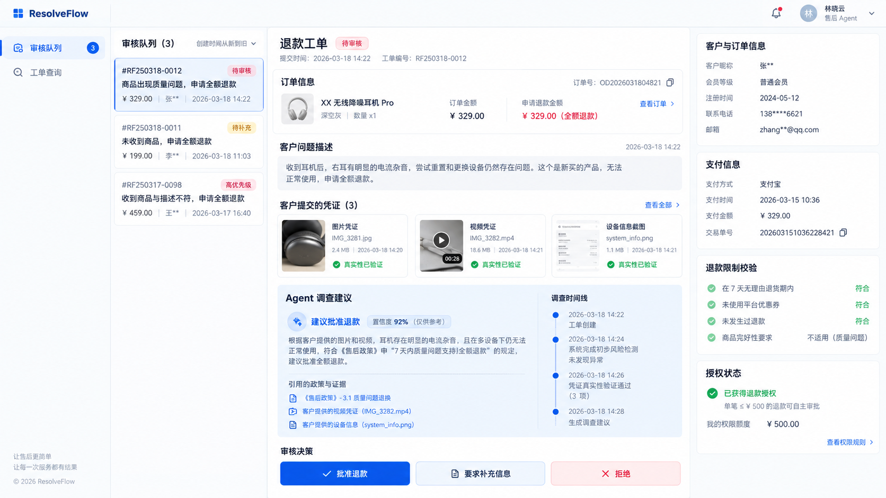

# ResolveFlow 审核工作台视觉对齐 v2

> 2026-09-28。基准为用户选定的下图。它是布局与信息层级的目标，不是数据或业务功能的证明。本文细化已认可的轻量工作台设计；`docs/core-scope.md` 的退款、授权和 Agent 边界保持不变。C12 未提交成果与账本由原任务继续维护。

## 目标、使用者与成功条件

商家审核员打开待审退款工单后，应在一个连续的阅读面内完成“辨认诉求 → 核对订单与材料 → 阅读 Agent 建议和来源 → 查看授权 → 作出人工决定”。目前真实页面已能显示客户描述和订单已付金额，但宽屏上三张大卡片分散，主列窄、纵向留白大，证据与时间线占用主线，旧演示样本还存在待审状态却无可见授权的情况。

本轮视觉成功条件：

1. 以目标图的左导航、队列、主内容、右侧上下文为基准；在 1600–1700px 宽屏有清楚的四区层级，在约 1280px 仍能阅读主列，在 390px 无横向溢出。
2. 首屏先看到问题、订单已付金额与 Agent 建议；若服务端存在待审授权，能找到审核区，按钮不被折叠或覆盖。
3. 真实字段和状态均可回溯到现有鉴权 API；缺少数据时明确为空，不使用概念图的姓名、图片、支付方式、校验条目或置信度。
4. 客户建单、补证、审核员核验、版本冲突与 SSE 现有行为保留；审批仅在后端授权状态允许时出现。

## 目标图拆解与现状差距

| 区域 | 可直接对齐的视觉/交互 | 当前真实数据 | 缺口与处理 |
| --- | --- | --- | --- |
| 左导航/队列 | 稳定窄导航、紧凑队列、明显选中态、更新时间 | 商家隔离的待审队列、客户描述 | 不增加概念图的工作台/运营菜单；队列编号降为辅助信息，完整查询保留 |
| 工单抬头/订单摘要 | 状态、问题标题、订单行信息在上方连续阅读 | 描述、状态、SKU/类别/数量/已付金额 | 无营销商品名和图片；金额注明“已付”，不能写成已批准退款额 |
| 客户问题/证据 | 原文独立浅灰区、证据有来源与核验状态 | 描述、文本 EvidenceView、可核验记录 | 现有材料为文本；不画假的图片/视频缩略图，不宣称自动真实性已验证 |
| Agent 建议/时间线 | 蓝色建议区并列简短轨迹，引用按需展开 | 方案摘要/动作/引用、工单 timeline | 摘要可能为英文合成文本；不把事件时间线称为模型逐步 trace，不把 confidence 当权限 |
| 右侧订单/授权 | 分组信息、金额、授权状态清楚 | 鉴权订单行、工单/授权版本 | 无客户画像、支付渠道、规则明细；待审无授权的旧样本先核对根因，不在 UI 伪造 |
| 人工决定 | 审核理由与批准/补证/拒绝集中 | 现有 reviews API、If-Match 和 authorization_version | 仅授权 `PENDING_REVIEW` 可显示；批准不是退款成功，409 后重读 |

## 页面结构与适配

- 顶栏高度约 56px；左导航约 190–210px。内容自顶栏下方直接展开，减少目前大标题区和多层卡片的重复留白。
- ≥1500px：队列约 290px，主列最少 540px，右栏约 300px；区间边界用细线/浅底，主列为视觉中心。约 1200–1499px：保留队列与主列，右栏放到主列下方或可见的摘要区，不能把主列压到难以阅读。≤850px：依次为队列、工单、上下文，所有审核操作保持可见。
- 主列顺序：工单状态/问题 → 订单行摘要 → 客户原文 → 证据/核验 → Agent 建议与实际引用/简要时间线 → 人工决定。空证据与缺授权有明确解释，不用大面积空卡撑高度。
- 使用现有浅色、蓝色重点、细线、状态色；统一 8px 节奏，标题强调业务语义，原始编号、版本与 JSON 收在展开区。保持键盘焦点与角色/状态文字，不依赖颜色独自传意。
- 右栏只显示可信字段；所有加载、404、403 和网络失败保留已有工单，不能把缺失字段误写为“符合退款规则”。

## 执行切片与验收

每一片先以真实浏览器/现有组件测试确认基线，再做局部修改；验证通过后仅提交本片文件。C12 文件和 `tasks/todo.md` 当前脏状态不纳入前端提交。视觉检查与功能检查并行，但静态 CSS 微调不写仅复述实现的测试。

| 顺序 | 交付 | 主要文件 | 验证 |
| --- | --- | --- | --- |
| V2-0 | 固定目标图、字段映射与断点标准 | 本文、目标图、原设计文档索引 | 人工核对范围与 `git diff --check` |
| V2-1 | 顶栏、导航、队列、主列的密度和响应式布局；首屏语义顺序 | `web/src/App.vue`、必要的组件测试 | `pnpm --dir web test`、`pnpm --dir web build`，浏览器 1670/1280/390px 无横向溢出 |
| V2-2 | 订单摘要、原文、文本证据与核验结果重排 | `web/src/App.vue`、`web/tests/app.spec.ts` | 不编造媒体；证据为空、有证据、需核验均可读；原测试通过 |
| V2-3 | Agent 建议与引用、时间线、审核区的决策路径 | `web/src/App.vue`、`web/tests/app.spec.ts` | 有/无授权、409、批准后状态均按真实响应；键盘可达 |
| V2-4 | 核查旧演示“待审但无授权”记录与样本生成路径；仅修真实根因，复核宽/窄屏 | 先只读定位，再决定测试和必要文件 | 不改库/清卷/造授权；记录结果与未解决缺口 |
| V2-5 | 构建一条可追溯的本地合成待审退款样本，复核真实字段在 1670px 的呈现 | `scripts/seed_review_showcase.py`、`web/src/App.vue`、`web/tests/app.spec.ts` | 验证服务端金额/授权、来源标注、材料核验关系及首屏剩余差距；不执行退款 |

验证入口：`pnpm --dir web test`、`pnpm --dir web build`；浏览器连接本地 core profile 的合成数据。若需改后端，只用 JDK 21 执行受影响 Java 测试/Spotless。无偿付费模型调用，无新依赖、路由或运营后台。最终以截图和实际操作路径核对，不以目标图像素完全一致冒充已实现能力。

## 执行记录

- 2026-09-28 V2-0：固定用户选定目标图、布局断点、字段来源和执行切片；提交 `30c83ac` 已推送到 `origin/main`。
- 2026-09-28 V2-1：审核员登录后默认打开队列首项；导航、队列和三栏改为连续工作台布局，窄屏保留单列。`pnpm --dir web test` 18/18、`pnpm --dir web build` 通过；本地浏览器在 1670、1280、390px 视口检查均无横向溢出。实际旧样本仍无证据/授权，Agent 摘要为英文合成文本，留给后续切片处理。
- 2026-09-28 V2-2：将真实订单行与“已付金额”移到主列诉求下方，右栏保留工单编号与授权；材料显示类型、正文、来源、时间及人工核验结果，核验记录不能再被核验。无材料时给出明确的小型空态，不渲染图片/视频。测试 18/18、构建通过；本地 1670px 浏览器核对订单与空材料状态。旧样本依然无材料与授权，未把这些状态填成概念图的示例数据。
- 2026-09-28 V2-3：Agent 建议与真实工单轨迹在宽屏并列；方案证据和政策引用按原始 `source_ref`/政策规则显示，完整载荷仍可展开；右栏展示工单状态和授权。待审但无授权时明确解释不能批准，保留已有 409 重读与审批按钮的服务端门禁。组件测试 18/18、构建通过；本地 1670/1280/390px 浏览器无横向溢出。轨迹是工单事件，不等同于模型逐步推理；旧合成样本的英文摘要保持原文，未伪装成真实模型效果。
- 2026-09-28 V2-4 样本审计：只读打开本地队列 4 项，3 项的方案为 `MANUAL_REVIEW` 且无授权，英文摘要逐字对应 `scripts/e2e_resident_dispatch.py` 的 mock 决策；Java `AuthorizationService.create` 仅为已校验、可执行的退款方案建授权，因此这不是“漏建授权”。第 4 项状态仍是 `PENDING_REVIEW`，但授权为 `CONSUMED`，轨迹包含一次审核决定与两次执行更新；`CaseResultConsumer` 对确定失败有退回人工的路径，但仅凭视图摘要不能断言该单具体退款结果。队列按工单状态筛选，不保证每项都有当前可批准授权。页面现按“无授权”和“已有非待审授权”分别解释，显示已消费/失效等真实状态，不重建授权、不改演示库。若以后要让审核员在无授权工单上形成可执行退款方案，需单独设计并接入现有人工方案 API，不在本次视觉切片假造按钮。
- 2026-09-28 V2-5 展示数据：运行 `agent/.venv/Scripts/python.exe scripts/seed_review_showcase.py`，在本地 core demo 创建合成订单行、LOST 物流记录，再经鉴权 API 创建工单、客户陈述、审核员确认与人工全额退款方案。Commerce 当前无公开建单 API，订单和物流由现有 e2e fixture 路径写入本地测试库。服务端钉住政策 `R-LOST-001`、重算 32900 分并建立 `PENDING_REVIEW` 授权；未审批、未执行退款、未调用付费模型。工单 `d3cd4ec2-ed0d-4ab8-b0b5-2499b3419540`，订单行 `9115821`，本地报告在忽略提交的 `tmp/frontend-review-showcase/20260928-040044-result.txt`。第一次提交政策引用时哈希不一致，被 API 以 422 拒绝；改从本地政策索引读取与服务端一致的引用后，在同一工单成功，无第二条样本。`--resume-case` 对已完成工单只核对状态，不重复提交方案。
- 2026-09-28 V2-5 页面：方案标题按 `origin` 区分 `HUMAN`/`AGENT`，待审退款额仅取服务端已校验的 `recomputed_amount_minor`。客户陈述展示关联核验结果，已有核验时隐藏重复核验入口；两条文本材料在宽屏并排，技术来源编号收在展开区，标题从原文提取首句而完整描述仍保留。`pnpm --dir web test` 19/19、`pnpm --dir web build`、脚本编译及重复运行核验通过。1670px 本地浏览器已看到上述真实字段与授权；人工决策区仍在首屏下方，需要滚动。

## 1670px 对照后的剩余差距

目标图的主要视觉内容依赖更丰富的业务数据：商品图、客户画像、支付信息、媒体证据和规则逐项校验。当前核心 API 只提供订单行、文本证据、方案引用与授权；这些右栏模块与缩略图不能由前端推断。当前 Agent 容器调查入口未启用，本条方案来自审核员，不能当作真实 Agent 效果展示。即使补齐真实样本，文字材料和完整引用也使决策区落在首屏下方；下一轮纯视觉优化可将方案引用默认折叠、压缩轨迹与表单间距，前提是保留审核依据的可访问性。媒体证据与客户/支付详情若要进入产品，须先定义可信来源和服务端契约，再设计组件，不属于本次 V2-5。

## V3 浏览器高保真样板（2026-09-28 用户确认）

### 目标与范围

以本文目标图为唯一视觉基准，先做真实浏览器可操作的样板，经用户确认后再接现有 API。样板不是新增业务功能，也不代表 Agent、媒体识别或退款效果。当前首要问题是布局与组件还原不足，不能以接口字段不完整替代视觉验收。

- 使用现有 Vue / TypeScript / Vite 锁，不引入组件库、路由框架或全局样式重构。开发入口 `http://127.0.0.1:5173/?preview=review`，顶部始终标识“设计预览 · 合成数据”；正常入口保持现有工作台，生产构建不开放预览入口。
- 1670×940、100% 缩放：顶栏 52px；导航 208px；队列 294px；右栏 354px；中间主列自适应约 814px。主列单一工单抬头，订单摘要、客户描述、紧凑材料、蓝色建议/时间线和审核操作均应在首屏可见。主内容和队列可独立滚动，内容不得被操作区遮挡。
- 色彩：主蓝 #165dff，正文 #14233e，次级 #7b89a2，边框 #e5ebf4，画布 #f7faff。正文 13–14px、区块标题 16px、工单标题 22px；圆角 7–10px，以 8px 节奏统一间距。避免重复大标题和大面积空框。
- 1280px 缩小导航与队列，右栏转到主列后；390px 使用单列，无横向溢出。默认 1670px 样本优先保证阅读完整，不以缩放浏览器来凑首屏。
- 合成场景：耳机质量问题、物流未收到、描述不符三张工单。订单/客户/支付/核验/授权数据均为样板数据。媒体卡片使用本地演示素材，人工核验明确写为人工，不写“真实性自动验证”，不填模型置信度。
- 交互：队列切换时整页上下文同步；材料/政策/订单可查看详情；批准、补证、拒绝先展示理由弹窗，提交仅改变本地预览状态并明确提示未提交真实工单；Escape/关闭可退出弹窗，键盘焦点可返回。无需登录、无后端写请求。

### 文件与执行切片

V3-0：本规格落地；V3-1：`web/src/preview/` 内的页面、样式、图标和本地素材，`web/src/main.ts` 开发预览入口，`web/tests/review-preview.spec.ts` 覆盖队列/弹窗/模拟操作；V3-2：浏览器对照修正、截屏与验收记录。按既有 Vue `<script setup lang="ts">` / 组件测试写法实现，交互状态局限在预览组件，不向现有业务状态注入假字段。确认外观后再确定生产组件复用和字段接入清单。

### 验证

命令：`pnpm --dir web test`、`pnpm --dir web build`、`git diff --check`。交互先写失败测试，静态样式以实际浏览器验收。浏览器检查 1670×940 下四区边界、材料与建议卡、操作按钮的可见位置；检查 1280/390px 无横向溢出；实际点击队列、材料、政策、取消和模拟提交；检查控制台。输出真实页面截图，不能用生成图代替实现截图。C12、付费模型、数据库和生产审批不在本次验收范围。
