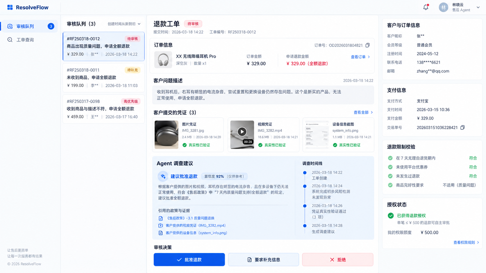

# ResolveFlow 工作台改版设计草案

> 状态：视觉方向与页面结构均于 2026-09-28 获用户认可；下述轻量工作台已按现有接口实施。本文不改变 C12 进度或业务范围；`tasks/todo.md` 中未提交的 C12 工作继续保留。

选定目标图的后续视觉对齐与分步验收见 [审核工作台视觉对齐 v2](frontend-review-v2.md)。

## 1. 目标与边界

将现有单页表单整理成可演示的售后退款工作台，使体验者能看清「提交诉求 → Agent 调查 → 人工审核 → 模拟退款结果」以及每一步的证据和状态。服务对象是演示中的客户和商家审核员；仍遵守 `docs/core-scope.md` 的轻量界面范围，不建完整运营后台。

固定业务边界：单订单行全量模拟退款；Agent 只给建议，不审批或执行退款；`APPROVE` 不等于退款成功；授权消费后的输入不能再修改或取消。所有展示状态来自服务端，不按模型置信度推断授权。

## 2. 视觉基准

该图只确定浅色、克制蓝色、细边框、三栏信息层级。图中的商品图片、客户资料、优惠券、规则条目、数值和部分菜单由图像模型虚构，**不得作为功能或数据契约**。界面文字、状态、动作与组件以本规格及真实 API 为准。

| 设计令牌（候选值） | 用途 |
| --- | --- |
| `#F8FAFC` / `#FFFFFF` | 页面底色 / 面板 |
| `#0F172A` / `#64748B` | 主文字 / 辅助文字 |
| `#2563EB` | 选中项、主操作、链接 |
| `#E2E8F0` | 边框、分隔线 |
| 绿 / 琥珀 / 红 | 成功 / 等待 / 错误；必须同时显示文字 |

桌面端审核页：窄导航、约 280–320px 的队列列、自适应的工单主列、约 260–320px 的上下文列。窄屏依次呈现队列、工单、上下文，不让审核按钮被横向滚动遮挡。具体尺寸以浏览器实测调整。

参考：[Chatwoot 客服工作台](https://www.chatwoot.com/features/shared-inbox)的信息分区、[Dify 执行详情](https://docs.dify.ai/en/cloud/use-dify/debug/step-run)的逐步检查方式、[shadcn-vue 主题令牌](https://www.shadcn-vue.com/docs/theming)的一致性；不照搬其产品功能或更换现有 Vue 技术栈。

## 3. 页面与流程

### 登录

保留本地演示账号登录。成功后由服务端返回的 `CUSTOMER`、`REVIEWER`、`OPERATOR` 角色决定入口；登录页不展示未经验证的业务统计。

### 客户入口

1. 订单行列表：显示现有 `line_id`、`sku`、已付金额、币种、状态；选中单行后填写情况说明。
2. 创建工单：调用现有幂等接口，成功后直接进入该工单详情。明确标注「单订单行全量模拟退款」。
3. 工单详情：展示状态、输入修订、证据文本、Agent 方案摘要（若存在）、事件时间线及模拟执行结果；允许在现有状态条件下追加文本材料和回答 `question_id`。
4. 目前只有通过已知工单 ID 查询的入口；在没有「我的工单列表」API 前，不设计可点击的完整工单历史列表。

### 审核员入口

1. 左列只显示当前商家的 `PENDING_REVIEW` 队列；显示工单 ID、状态、订单行 ID、更新时间。游标加载更多、手动刷新、空状态均保留。
2. 中列先展示客户原始问题描述，再展示状态、文本证据及核验结果、Agent 方案、时间线。原始结构化方案可展开查看。时间线不冒充完整的模型/工具逐步 trace。
3. 右列通过已鉴权的订单详情读取选中订单行的 SKU、类别、数量和已付金额；金额不冒充批准退款额。工单和授权编号/版本可展开查看。商品营销名、图片和客户资料不填假值。
4. 只有授权状态为 `PENDING_REVIEW` 时展示审批区。要求先填写理由，再提交批准、拒绝或请求补证；将「批准」文案说明为批准授权，后续执行仍有独立状态。发生 409 时提示页面已过期并重新读取工单，不盲目重试旧决定。
5. 证据核验保留 `CONFIRMED`、`REFUTED`、`INCONCLUSIVE` 三种结果和必填理由；核验动作与退款审批分区，避免误以为确认一份证据就已批准退款。

## 4. 现有接口映射与数据缺口

| 界面能力 | 现有来源 | 约束 |
| --- | --- | --- |
| 登录/角色 | `POST /api/v1/auth/login` | Bearer token 只进请求头 |
| 客户订单行 | `GET /api/v1/orders` | 游标分页；仅当前主体 |
| 创建工单 | `POST /api/v1/cases` | `Idempotency-Key`；请求仅 `REFUND` |
| 工单详情 | `GET /api/v1/cases/{case_id}` | case 增加已保存的客户描述和订单 ID；仍按原主体权限读取 |
| 选中订单 | `GET /api/v1/orders/{order_id}` | 按主体权限取订单行，前端再按 case.line_id 选中；失败时不编造金额 |
| 实时更新 | `GET /api/v1/cases/{case_id}/events` | 带鉴权和 `Last-Event-ID`；收到事件后重取快照 |
| 追加材料 | `POST /api/v1/cases/{case_id}/evidence` | 文本材料；成功后旧 revision 决定失效 |
| 审核队列 | `GET /api/v1/review/cases` | 仅待审，商家隔离，游标分页；增加数据库已有的客户原始描述，不增加逐行查询 |
| 证据核验 | `POST /api/v1/cases/{case_id}/reviewed-evidence` | 三态结果及理由 |
| 人工决定 | `POST /api/v1/cases/{case_id}/reviews` | `If-Match` 工单版本 + 授权版本；409 需刷新 |

尚无与概念图对应的「我的工单列表」、图片/视频上传预览、完整客户画像、商品营销名称、独立 Agent run trace 查询和运营图表。它们不进入本轮前端实现。订单详情路由已核对为本人/商家权限内读取，右侧展示的是实际返回的订单行已付金额。

## 5. 交互与验收

- 状态、时间、金额统一格式化；请求中、空数据、断流、接口错误各有可见反馈，错误不遮盖已有工单内容。
- 客户和审核员的操作入口按角色和服务端状态显示；前端隐藏不替代后端鉴权。
- SSE 断线状态可见；重连延续现有游标语义，切换工单时停止旧流。
- 审核提交有防重复交互和 409 冲突提示；批准后仍显示后续 `AUTHORIZED` / `EXECUTING` / `RECONCILING` / 终态，不立即显示「退款成功」。
- 桌面与窄屏布局均能完成各自核心流程；按钮、标签和错误有可读文字与键盘焦点。
- 不以 mock 图中的数字、虚构证据或静态假数据充当后端结果。

## 6. 实施切片

1. 抽出基础布局与设计令牌；现有登录、客户、审核流程和测试保持可用。
2. 重排客户订单行/建单/工单详情；用真实接口完成一次提交与查看。
3. 重排审核队列/工单详情/证据核验/审批；验证版本冲突和批准后状态。
4. 打磨窄屏、加载/空/错误/断流状态，浏览器走通双角色演示。

沿用 Vue 3、TypeScript、Vite、Vitest 和现有 `web/src/client.ts` / `web/src/events.ts`，没有增加组件库。为让真实描述与订单上下文进入页面，后续切片对核心只读契约做了追加字段；不得覆盖 C12 未提交改动。

## 7. 2026-09-28 实施与验证记录

- 文件：`web/src/App.vue`、`web/src/client.ts`、`web/tests/app.spec.ts`、本文及 `docs/assets/frontend-review-concept.png`。只动前端和本设计资料；C12 文件与账本未暂存、未修改。
- 实现：审核员有队列/工单/上下文三栏；客户有订单行、中心建单表单及工单详情；窄屏依次排列；证据、方案与轨迹展示真实服务端数据；时间本地化，状态有中文标签。原有 Bearer/SSE/幂等键/审批版本约束保留。
- 真实浏览器先发现 `GET /cases/{id}` 在无材料时省略 `evidence`，新模板读取其 `.length` 会报错；写失败回归后在客户端把省略的集合归一为空数组。又增加 409 审批冲突的失败测试，提交被拒后重新拉取工单并提示重新核对。
- 命令与结果：基线 `pnpm --dir web test` **15/15**；改版后 `pnpm --dir web test` **17/17**，`pnpm --dir web build` 成功（含 vue-tsc）；`git diff --check` 通过。页面分区、空证据和 409 冲突测试均先见失败再修复。
- 浏览器：本机 Vite `http://127.0.0.1:5173/`，真实 core profile；演示客户能看到订单行和中心建单表单；演示审核员能看商家待审队列并打开一条真实工单；390px 视口下单列布局且 `scrollWidth <= innerWidth`。未在浏览器真正提交退款审批或运行收费 Agent；不把图像模型的伪字段当作系统能力。当前演示样本的 `PENDING_REVIEW` 工单返回中没有 authorization，因而该样本不显示审批按钮，需在后续业务数据验收中核查。

## 8. 2026-09-28 描述与订单上下文修正

- 根因：Case 已存客户描述和订单 ID，队列 SQL 也读取了描述，但两个公开只读响应丢弃这些字段；前端只好以 UUID 和订单行号作为标题。
- 变更：队列和详情增补原始描述，详情增补订单 ID，契约、Python 类型和 OpenAPI 示例同步。选中工单后按现有主体鉴权读取订单行，只展示真实 SKU、类别、数量与已付金额；金额明确不是批准退款额。队列/详情以问题描述为主，UUID 放入可展开技术信息；常见类别、时间线事件和方案动作显示中文标签，保留原始方案可展开。
- 验证：`CaseReadApiTest` 与 `ReviewQueueApiTest` 共 11/11；`test_contracts_core_routes.py` 71/71；`pnpm --dir web test` 18/18（含订单接口迟迟不返回时工单仍可操作），`pnpm --dir web build`、Java Spotless 和 Python Ruff 通过。真实浏览器连本地 core profile，四条待审数据的客户描述正常显示；选中工单显示真实描述及 25.99 CNY 已付金额，订单金额来自 `GET /api/v1/orders/{order_id}`。未重复做退款审批、收费模型评测或完整性能压测。
- 数据边界：订单接口只有类别和 SKU，没有营销商品名/图片；旧演示样本部分无授权，不展示审批操作。队列字段追加未增加逐项查询，C11 性能指标仍需按独立验收口径复测。
