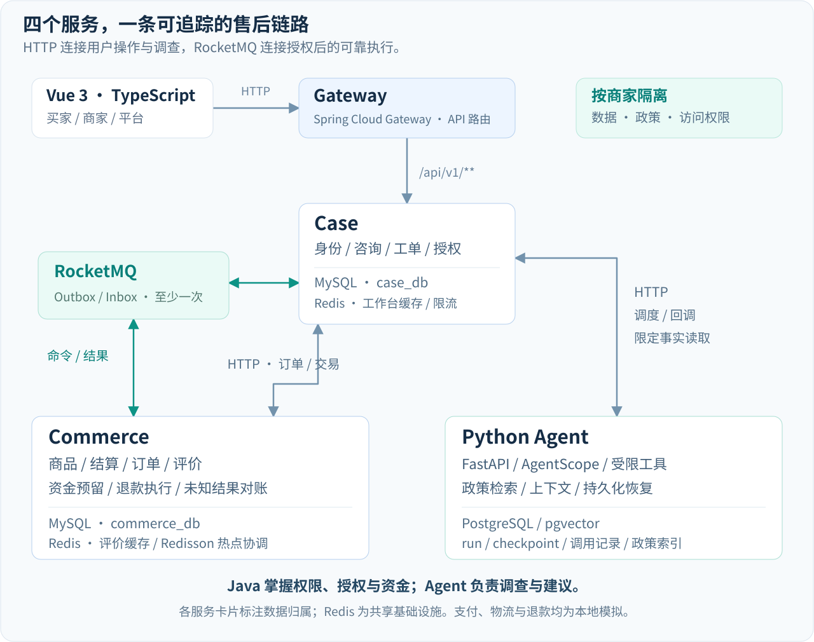

# 系统设计

多商家商城与智能售后个人项目，支付、发货和退款均为本地模拟。

Gateway 已按接口分流：公共商品/店铺目录、展示资料、公开评价及只读报价直接进入 Commerce；受保护交易、账户、图片字节及售后接口目前仍进入 Case。上图为此前完整售后链路，目录新增直连箭头以[边界调整方案](service-boundary-plan.md)及[网关路由](../java/gateway/src/main/java/com/resolveflow/gateway/CoreRoutes.java)为准。身份认证与可信绑定暂由 Case 提供，不把目录直连宣称为受保护交易已经解耦。Agent通过Case限定范围的事实入口读取订单、物流与会话；退款命令及结果由RocketMQ连接Case与Commerce。图中的缓存标注表示用途，Redis是共享基础设施；Case与Commerce分别持有自己的MySQL业务库。调用实现见[Agent调度](../java/case-service/src/main/java/com/resolveflow/caseservice/support/SupportAgentClient.java)与[事实读取](../agent/src/resolveflow/support/sources.py)。

| 组件 | 职责 | 数据 |
| --- | --- | --- |
| Gateway | 公共HTTP路由 | 无业务库 |
| Case | 身份/店铺绑定、咨询/工单、修订/人工授权、命令Outbox | MySQL case_db |
| Commerce | 商品/购物车/结算/订单/评价、资金与退款、结果Outbox | MySQL commerce_db |
| Python Agent | AgentScope、受限工具、政策检索、上下文/恢复 | PostgreSQL/pgvector |
| Vue3 | 买家/商家/平台页面 | 经Gateway访问 |

商城：商品→按店购物车→不可变结算快照→模拟付款→订单/行/账本原子发布→履约/评价。

售后：咨询/申请→Agent读订单/物流/材料/政策→补证/人工核验审批→消费当前授权→MQ退款命令→预留/模拟执行→结果消息/对账→买家进度。

## 约束

- 买家跨店基于持久buyer/customer绑定，商家查询带本店范围；Agent不能跨主体读取。
- Java拥有业务权限、工单/授权/金额，Agent只读调查/建议；confidence不是授权。
- 授权绑定input_revision，补证使旧授权失效；消费前可撤销，消费后冻结输入。
- 同行最多一次成功退款；整单已退+预留不超实付；UNKNOWN保留占用和原operation_id，不换ID重付。
- Outbox至少一次；Inbox/业务效果/本地结果事件同事务；外部调用在资金短事务外。
- checkpoint/回调受fence保护，已存模型结果可复用，未存响应可能重复计费。

## SQL与Redis

订单页按页批量读取并限制商家/客户范围，在只读RR事务固定本页now；Case跨店归并不是全局数据库快照。

工作台展示缓存TTL2秒。评价首页/摘要按product+数据库epoch缓存30秒，每次仍查epoch。Redisson只协调重建：100ms等待、显式2秒租约、锁内二查、失所有权不回填/误解锁，资金仍由MySQL保护。

Lua按账号/动作限写频率；Redis故障写入503。读回源本机8许可/100ms，双Commerce最多16，非全局8。超租约/Redis故障可能重叠，不能称所有故障始终互斥。

源码：[交易与缓存](../java/commerce-service/src/main/java/com/resolveflow/commerce/catalog)、[工单授权](../java/case-service/src/main/java/com/resolveflow/caseservice/casefile)、[退款](../java/commerce-service/src/main/java/com/resolveflow/commerce/refund)、[Harness](../agent/src/resolveflow/harness)、[客服上下文](../agent/src/resolveflow/support)、[核心契约](../contracts/core)。
