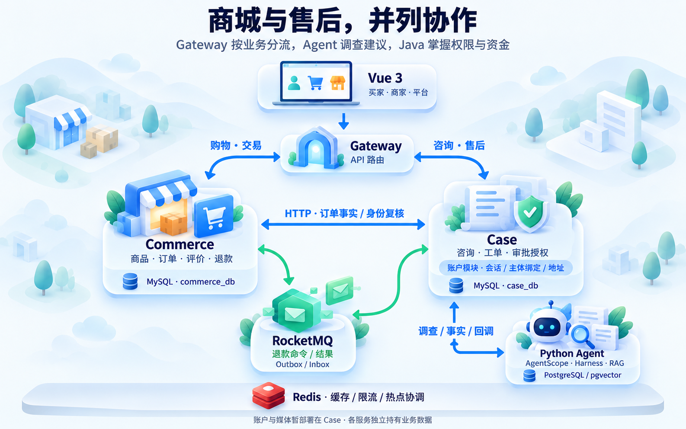

# 系统设计

多商家商城与智能售后个人项目，支付、发货和退款均为本地模拟。

Gateway 将商品、购物车、结算付款、订单、履约、评价及商家商品管理请求直接路由到 Commerce；账户、咨询与售后请求进入 Case。Commerce 通过受限身份协议向账户模块实时复核账号、会话版本与可信绑定，再独立校验交易资源归属。账户模块暂部署在 Case，因此受保护交易仍依赖该进程的可用性；公共目录无需调用账户模块。商品媒体文件及其归属暂在 Case，图片上传/读取和依赖图片归属的商家展示资料写入保留原入口。旧 Case 商城门面默认关闭，仅显式兼容测试启用。

Case 按需查询 Commerce 的订单与物流事实，调度 Agent 调查并接收建议；退款命令与结果通过 RocketMQ 衔接，Case 管授权，Commerce 管资金。Case、Commerce 分别持有自己的 MySQL 库，Redis 是共享基础设施。详见边界方案（本地开发记录）、[网关路由](../java/gateway/src/main/java/com/resolveflow/gateway/CoreRoutes.java)、[身份客户端](../java/commerce-service/src/main/java/com/resolveflow/commerce/security/IdentityAccessClient.java)、[Agent调度](../java/case-service/src/main/java/com/resolveflow/caseservice/support/SupportAgentClient.java)与[事实读取](../agent/src/resolveflow/support/sources.py)。

| 组件 | 职责 | 数据 |
| --- | --- | --- |
| Gateway | 公共HTTP路由 | 无业务库 |
| Case | 身份/店铺绑定、咨询/工单、修订/人工授权、命令Outbox | MySQL case_db |
| Commerce | 商品/购物车/结算/订单/评价、资金与退款、结果Outbox | MySQL commerce_db |
| Python Agent | AgentScope、受限工具、政策检索、上下文/恢复 | PostgreSQL/pgvector |
| Vue3 | 买家/商家/平台页面 | 经Gateway访问 |

商城：商品→按店购物车→不可变结算快照→模拟付款→订单/行/账本原子发布→履约/评价。

售后：咨询/申请→Agent读订单/物流/材料/政策→补证/人工核验审批→消费当前授权→MQ退款命令→预留/模拟执行→结果消息/对账→买家进度。

## 约束

- 买家跨店基于持久buyer/customer绑定，商家查询带本店范围；Agent不能跨主体读取。
- Java拥有业务权限、工单/授权/金额，Agent只读调查/建议；confidence不是授权。
- 授权绑定input_revision，补证使旧授权失效；消费前可撤销，消费后冻结输入。
- 同行最多一次成功退款；整单已退+预留不超实付；UNKNOWN保留占用和原operation_id，不换ID重付。
- Outbox至少一次；Inbox/业务效果/本地结果事件同事务；外部调用在资金短事务外。
- checkpoint/回调受fence保护，已存模型结果可复用，未存响应可能重复计费。

## SQL与Redis

订单页按页批量读取并限制商家/客户范围，在只读RR事务固定本页now；Case跨店归并不是全局数据库快照。

工作台展示缓存TTL2秒。公开商品详情和展示资料缓存60秒，评价默认10条首页/摘要独立缓存30秒，均先读Redis，命中不查MySQL版本。商品、评价写事务记录V23待失效项，提交后清理，失败定时重试；Redis代次及Lua条件回填拦截晚到旧结果。展示允许短暂滞后，报价与结算仍查数据库。Redisson协调重建，100ms等待，不指定固定租约，使用默认30秒看门狗窗口自动续期；锁内二查，失去所有权不回填或误解锁。

Lua按账号/动作限写频率；Redis故障写入503。商品展示和评价各有本机8许可/100ms的回源上限，两个池分别计数，跨进程并不共享许可。长暂停或Redis故障导致续期失败时仍可能重叠；客户端存活且续期正常时，业务卡住也可能继续持锁，因此看门狗不等于业务超时，也不能称所有故障始终互斥。

源码：[交易与缓存](../java/commerce-service/src/main/java/com/resolveflow/commerce/catalog)、[工单授权](../java/case-service/src/main/java/com/resolveflow/caseservice/casefile)、[退款](../java/commerce-service/src/main/java/com/resolveflow/commerce/refund)、[Harness](../agent/src/resolveflow/harness)、[客服上下文](../agent/src/resolveflow/support)、[核心契约](../contracts/core)。
