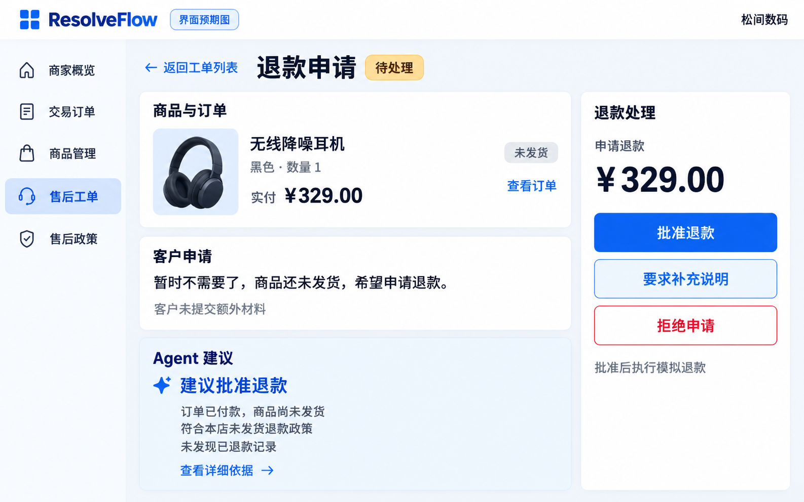

# 商家工单详情简约预期图与实施合同 v4

2026-10-04。用户先要求绘制简约预期图，随后明确批准按图修改。本合同替代v3的商家工单详情布局，v3的买家三页和商家列表继续沿用。实际截图、验证与限制见[实施报告](../../reports/aftercare-v4.md)。图中的例子不作为业务事实或权限依据。

默认一屏呈现四个区域：商品与订单、客户申请、Agent建议、退款处理。正文和辅助文字使用大字号，详细依据统一一个入口；取消零散版本/轨迹/原记录入口和重复说明。按钮使用业务语言，实际批准仍是授权后执行模拟退款，不能提前显示到账。

图片中的329元、未发货、政策适用和退款记录仅为设计示例，不是当前工单调查事实。落地必须按实际读取呈现，未检索政策不能写“符合政策”、未查退款不能写“未发现已退款”。旧建议、冲突、材料缺口、服务端拒绝及UNKNOWN须以简短具体提示直接可见，不隐藏到详细依据。处理按钮只显示服务端允许的动作，没有有效授权时不得因设计图开放批准。

内置image_gen生成，已目视核对中文、四区布局、大字号及无角落小字；PNG签名/尺寸完整性已检查。生成提示词见[prompt.md](prompt.md)。绘图阶段没有业务代码变化，实施验证独立记录。

实施规则：左侧三张卡片展示已付款商品快照/真实履约、原始申请和材料数量、实际建议；右侧集中人工处理与实际执行结果。正文18px、标题24–32px、主要处理按钮20px。只有一个“查看详细依据”入口，展开后保留完整原始材料及核验、引用、模型读取记录、政策原文/解释/服务端复核、人工记录与完整轨迹。mock或真实模型来源默认可见；读取失败和正文省略不伪装成正常调查。长申请或大量冲突允许页面自然滚动，不强制截断原诉求。

批准、拒绝、补证沿用原确认弹窗和当时读取的工单/授权/协作版本。没有当前有效待审授权时显示服务端允许的人工方案/补证/拒绝入口，不能按照图片提前开放批准。已消费、UNKNOWN、终态和上下文未就绪不开放新的批准；人工方案必须有真实材料引用和绑定政策，仍需后续审批。本轮不修改Agent判断、政策、后端接口或业务数据。
