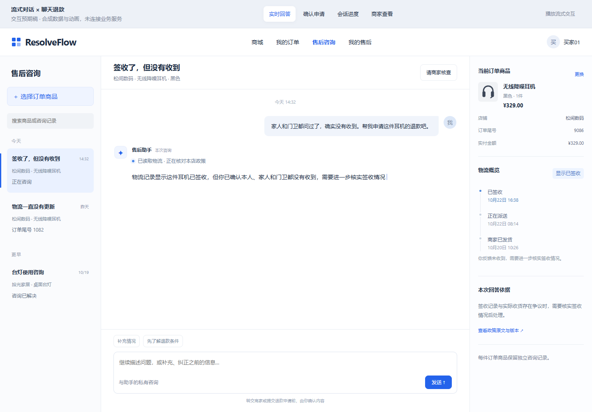
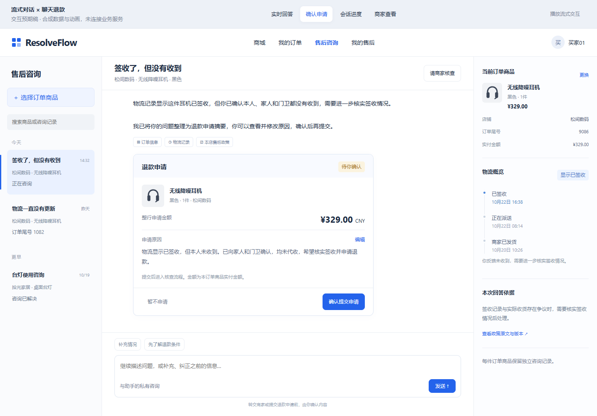
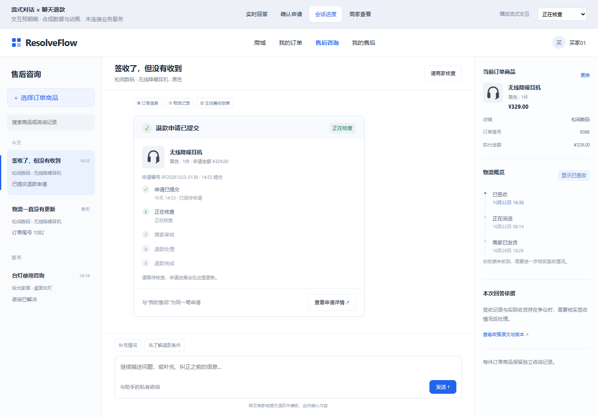
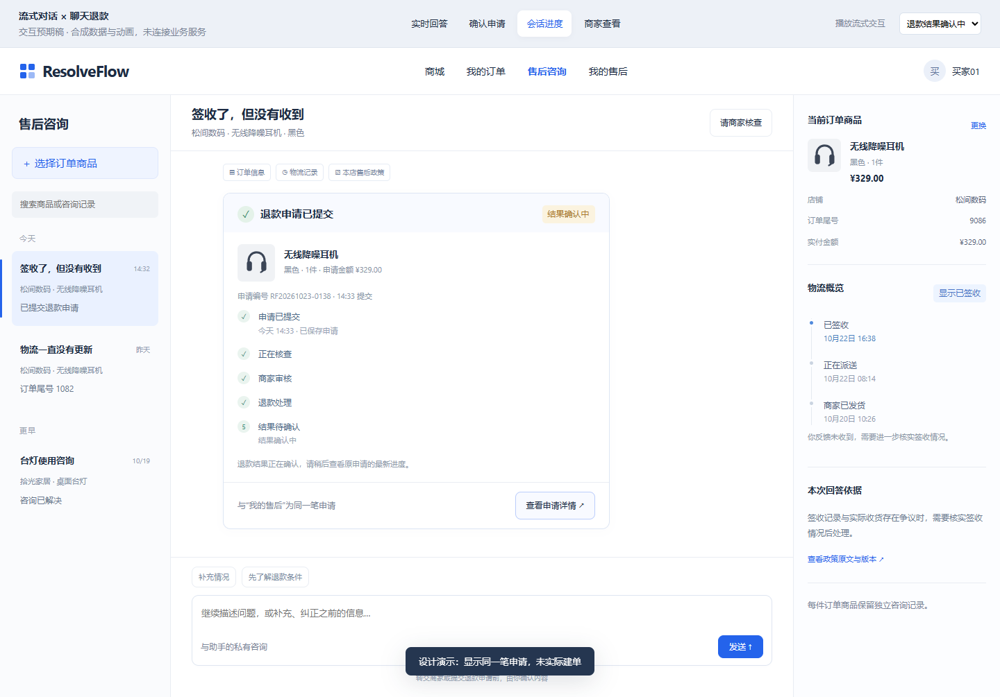
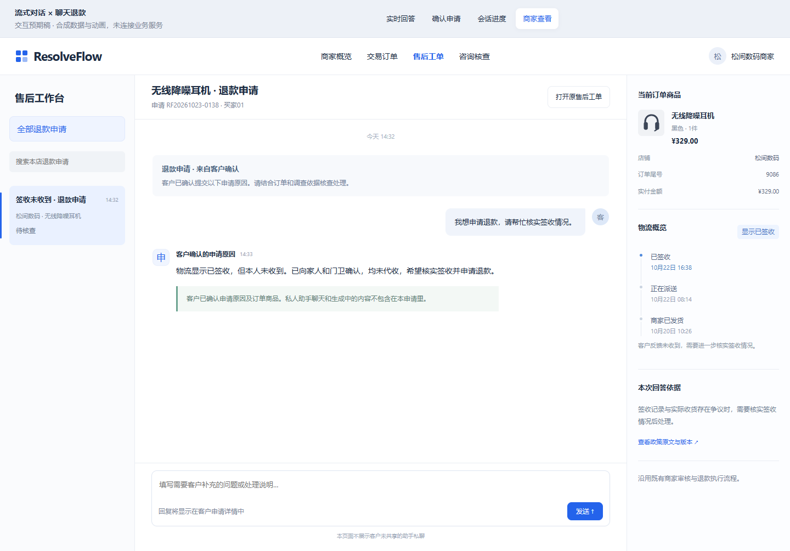

# 聊天退款与流式体验预期稿

2026-10-23，沿用已认可的蓝白三栏售后咨询风格，新增聊天内退款确认与进度，不重做商城。打开[可交互预期稿](index.html)，顶部可切换四个状态；所有内容/动画为合成设计样例，未调用模型、创建申请或连接原项目，不是实现截图/耗时结果。

| 状态 | 体验重点 |
| --- | --- |
| 实时回答 | 用户发送后立即反馈，调查进度与生成光标；点击“播放流式交互”演示进度→正文→卡片。此动画仅为预期，实际实现必须使用真实事件/Provider delta |
| 确认申请 | 卡片在聊天正文下，商品、权威整行实付金额、原因一屏可见；“编辑”弹层改原因，“暂不申请”保留原因，确认才进入申请状态 |
| 会话进度 | 同一张卡片转成申请进度，可打开同一笔申请详情；顶部状态示例可检查“结果确认中”不会写成退款成功 |
| 商家查看 | 沿用既有售后工作台，显示用户确认提交的申请原因/订单/材料，私有聊天与生成草稿不展示，不增加商家Agent |

桌面目标1440×1000及1280/1680宽度，消息/侧栏独立滚动，图册验证后保存PNG。协议/开发计划见[方案](../customer-chat-refund-stream-v1.md)与[目标协议](../customer-chat-stream-contract-v1.md)。申请只覆盖既有单行全量模拟退款，不暗示已批准、已支付或已实现退货物流/补发。

## 桌面预期图

已完成12个页面/宽度布局检查、9项交互检查和5幅截图；[检查记录](../../reports/chat-refund-stream-design-v1/preview-check.json)。首次检查发现tab选择器误含body、hash跳转未同步状态，均修正；视觉复核后调整卡片初始滚动位置，使确认按钮可见，商家不显示买家私人历史/换商品入口。仅预期稿QA，不等于新增生产测试通过。截图/HTML指纹见[清单](manifest.json)。

应用内预期文字使用普通客户语言；draft/attempt/SSE/模型预算等只在开发文档，不进入产品正文。后续正式界面使用实际可见字段/状态；设计稿的政策文案和编号不能作为商家政策或真实Case记录导入。
