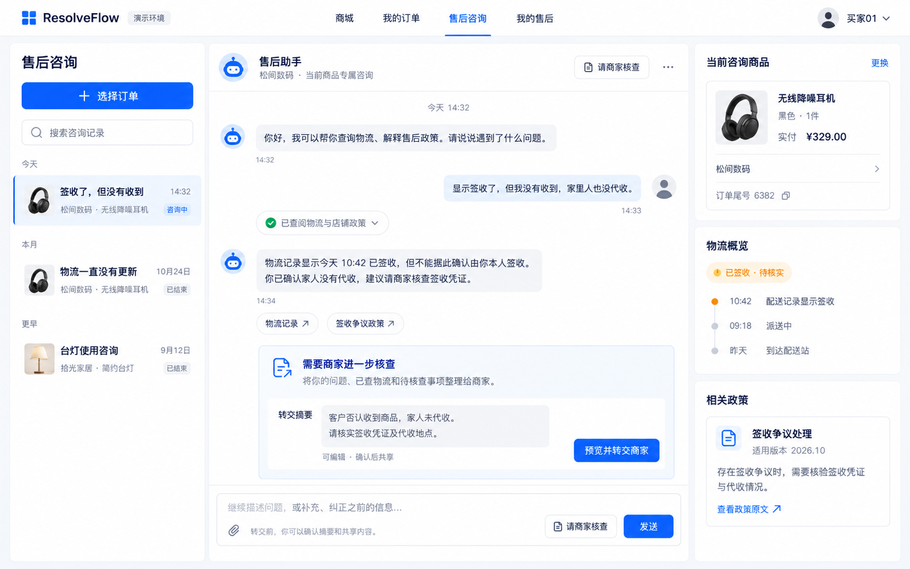
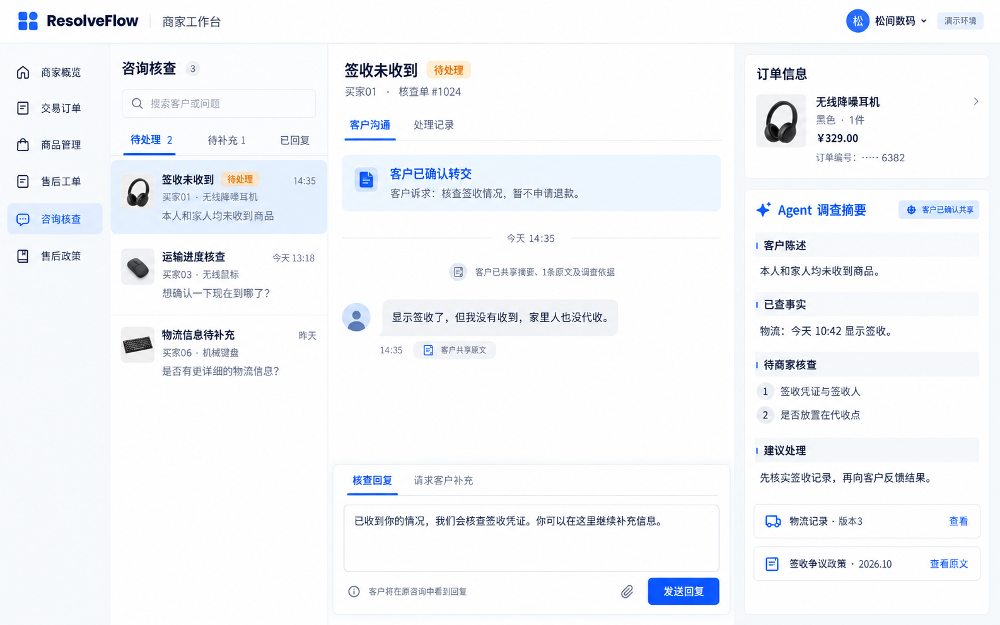

# 售后客服双端预期图 v2

同日用户已认可并授权实施；已完成的实际页面与验证见[界面v2报告](../../reports/customer-support-ui-v2/README.md)。下文保留原设计图与当时范围说明。

2026-10-20。用户认为现有买家/商家咨询前端体验差，要求参考成熟客服页面并用图像生成绘制双端预期图。本批只交付设计，未替换Vue页面或改变接口；当前实施进度只看[账本顶部](../../tasks/todo.md)。两图中的文案、队列数量和时间均为设计样例，不能作为实际业务记录或验收结果。

## 买家：对话为主，订单上下文随手可查

聊天区居中、消息按内容收窄，输入框固定在底部；左侧以问题摘要、商品/店铺和时间区分咨询，替代重复堆叠的大商品卡。右侧保留当前商品、物流概览和适用政策，政策原文按需展开。入口“选择订单”和“更换”预期打开轻量订单选择层，每行显示商品、购买日期、订单尾号和状态；选定后进入/恢复独立商品咨询，不把全部订单铺成页面主体。

Agent回答下用来源标签连接物流与政策，不常驻展开长原文或JSON。需要商家核查时出现摘要卡；“预览并转交商家”打开确认层，允许改摘要、选择共享原文及事实/政策依据，最终确认后提交。图中是提交前状态，不能将“生成建议”当作“已经转交”。客户仍能补充、纠正或直接要求商家核查，无固定提问顺序。

## 商家：待办、沟通、调查依据同屏

沿用现有商家导航，主体为“核查队列—客户沟通—订单/调查依据”三栏。进入后默认选中首条记录，减少空白等待；短列表按问题、客户、商品、时间和真实状态组织。中间仅显示客户确认提交的摘要/所选原文与此后双方消息，底部明确区分“核查回复”和“请求客户补充”。

右侧把客户陈述、已查事实、待核查事项和建议处理分层，来源可读回原文及版本。商家查看/回复不新增一次模型调用，第一版不提供商家另聊一个Agent、人员分配/团队路由、在线坐席承诺或自动退款/审批。咨询解决仍由客户确认，商家不能通过此页绕过原退款申请与审批。

## 成熟产品参考与本项目取舍

- [Intercom：Messenger更新](https://www.intercom.com/help/en/articles/9319961-updates-to-the-messenger)：参考内容优先的聊天头部、回答卡、明确AI/人工身份与接续状态；不引入商业平台的营销空间或全渠道能力。
- [Intercom：Messenger配置](https://www.intercom.com/help/en/articles/6612589-set-up-and-customize-the-messenger)：参考直接进入会话、仍能恢复历史的入口组织。
- [Zendesk：Agent Workspace](https://support.zendesk.com/hc/en-us/articles/4408821259930-About-the-Zendesk-Agent-Workspace/)：参考中央沟通记录与右侧客户/知识上下文同屏，减少来回跳页。本项目仍为单店单账号商家，不照搬分配、通话、跨渠道或Copilot付费功能。
- [Chatwoot：首次会话](https://www.chatwoot.com/hc/user-guide/articles/1677229173-lesson-1-your-first-chatwoot-conversation)：官方搜索摘要提供了队列/会话/右侧客户信息的布局参照；正文抓取超时，仅作补充，主要依据为前两家已读取的官方文档。

参考的是信息架构，布局与品牌为ResolveFlow重新绘制；不声称复刻任何产品的私有实现。

## 图与后续实现的边界

两图是信息层级和视觉方向，实施不能直接照抄AI生成的每个字或图标。买家/商家状态仍以现有Support协议为准；图中商家筛选与列表数量有示意性质，落地应让筛选、计数和实际队列一致。搜索/筛选可作为页面改造的细化项；附件图标不表示本批批准文件上传，第一版仍按现有文本和原文共享能力处理。商家调查摘要四区是目标展示结构，当前服务保存answer/citations/handoff_summary；若采纳此方向，再明确哪些字段确定性投影、哪些需要协议扩展，不能从图中反推已有能力。

继续保留本店/订单行归属、政策版本、私有咨询与已共享投影、用户确认共享及原退款约束。800px高度等较小桌面需分别滚动列表/会话/上下文；移动端和实际响应式效果未在本批实现或测试。原v1图册和运行实图全部保留。

生成方式与完整文本见[提示词](prompts.md)，文件hash/尺寸见[清单](manifest.json)。内置工具未返回模型ID，用户指定的GPT Image 2版本未单独核验。本批未调用业务LLM、重跑质量评测或修改业务代码；按用户后续“先关闭项目再继续设计”的要求执行标准stop，应用/所属容器及9个端口已关闭，数据卷保留。
