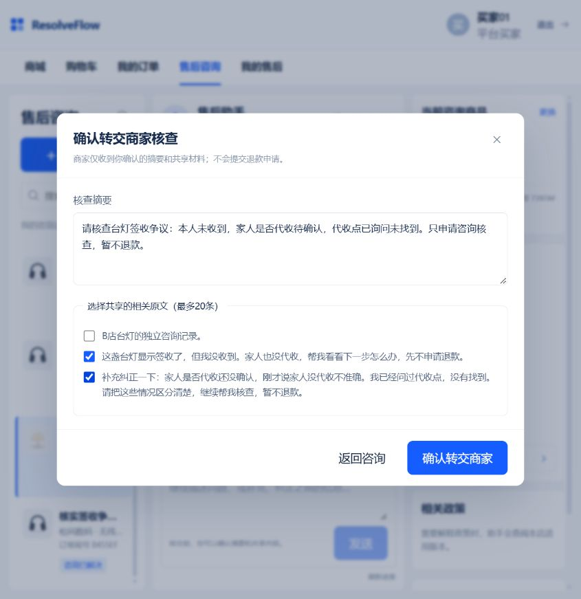
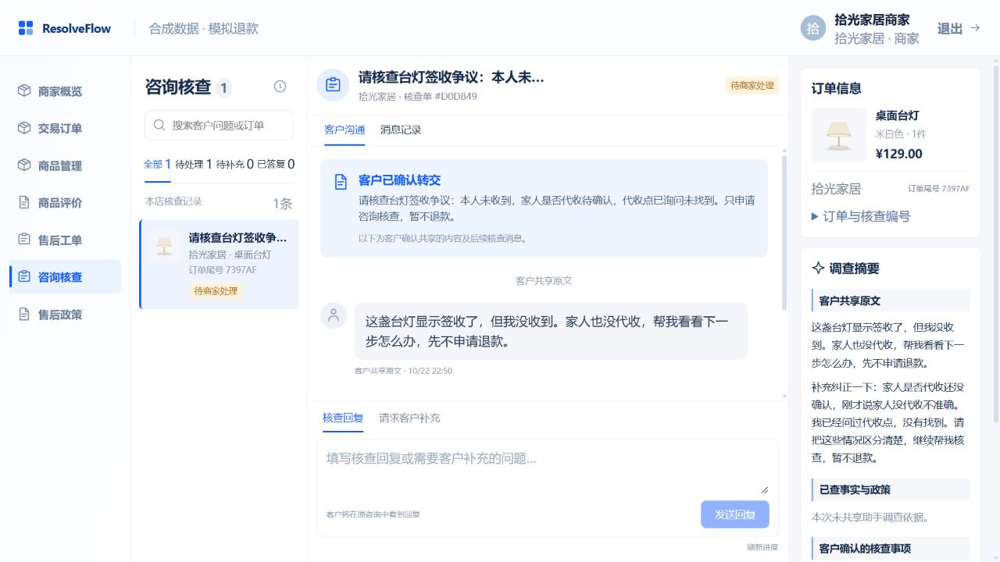
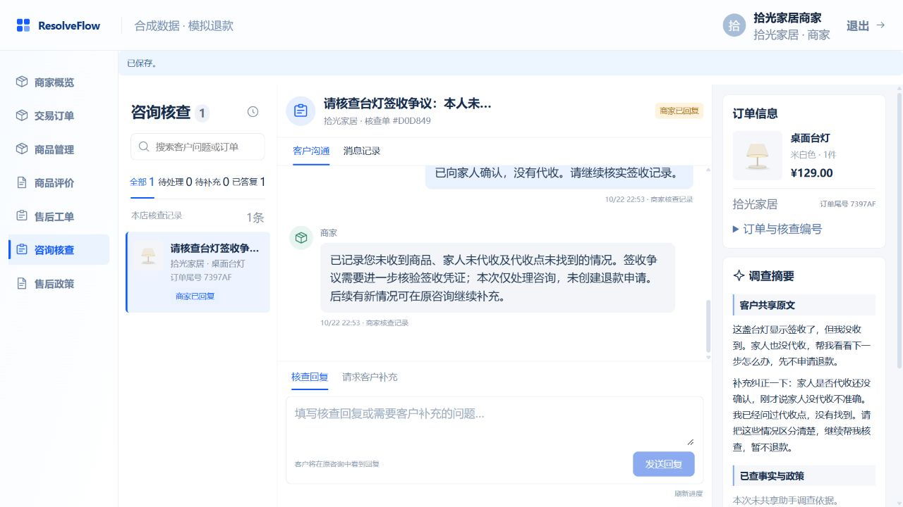
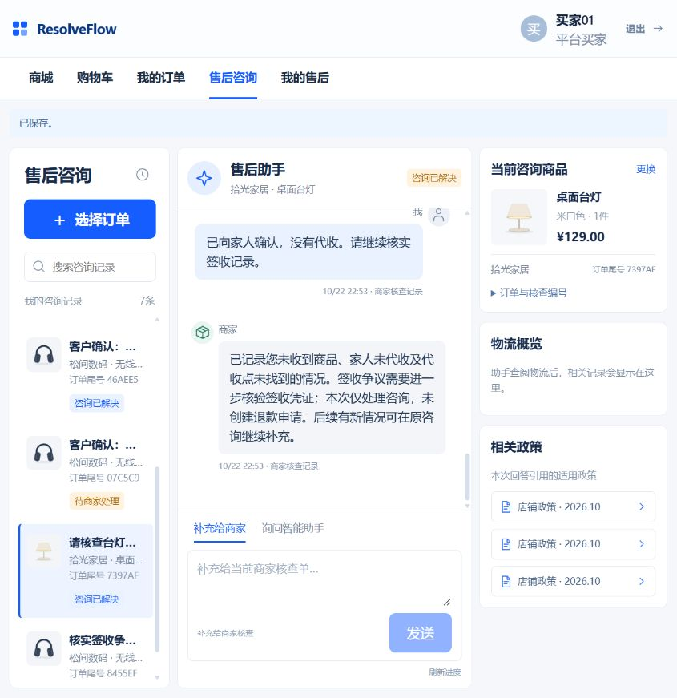

# 两阶段客服接入与真实网页验收

2026-10-22。按[本批方案](../../docs/customer-agent-demo-v2.md)，实际启动保留数据的完整演示，使用浏览器登录买家和商家，单次提交三条新助手消息。**双端核查流程通过；Agent三轮发布2轮、失败1轮，不能称整体质量验收完成。** 未修改简历、旧题、旧评分或旧真实轨迹。

## 实际运行与改动

- `project.ps1 start`明确选择`staged-v1`；服务启动固定架构、health可核验，运行中改环境不会切换。唯一AgentScope循环、原模型/RAG/预算和权限继续使用。独立兼容入口默认single保持。
- 同源客户陈述按主题、当前消息原句位置去重，保留显式替代/撤回关系；不同消息之间的语义纠正仍由理解阶段提出，不能靠同源去重自动完成。
- 新增资格答复assessment声明：一般条件不强制订单读取，当前订单明确判断须有ORDER/POLICY。旧可选字段兼容；本次第三轮没有输出该字段，不能宣称真实模型已稳定采用此声明。
- 新版使用指南`2026.10.22-v2`只描述入口和可用行为，移除“Case关联尚未接通”话术，保留v1原资产。当前run/manifest固定版本，不静默升级历史run。
- 启动器复用与权威bundle精确hash一致的唯一READY索引，避免正常体验启动强制`--replace`。原政策数据与索引在启动前后核对保持。

## 三条真实助手消息

使用既有B-SIGNED订单行（拾光家居台灯，尾号7397AF），原历史消息保留，新消息在实际页面输入。模型为实际部署配置`deepseek-flash`，非mock；业务数据为合成。

| 轮次 | 问题重点 | 实际工具 | 模型请求 | 结果 |
| --- | --- | --- | --- | --- |
| 1 | 显示签收但未收到、家人也未代收，询问下一步、暂不退款 | 物流、使用指南 | 4 | 发布；说明签收记录与客户陈述，给出请商家核查/预览确认入口，未虚构退款已提交 |
| 2 | 纠正为家人是否代收尚未确认，补充代收点已问过未找到 | 物流 | 4 | 失败；理解及草稿采用纠正，但首次facts未对应正文占位符；一次纠错后仍缺本轮GUIDE依据，未发布 |
| 3 | 转交后私下询问“若找回、个人不想要、未拆封”的一般退货条件 | 政策检索 | 3 | 发布；说明当前检索到的政策未覆盖该情形，保留未知，不承诺可退；未读订单也未报具体金额 |

原始模型请求、决策、工具返回、真实答复、买家/商家响应在[runtime-results.json](runtime-results.json)。文件SHA256：`0b3e19db6db684d7114446bd76ed93b5f39d21a6aae55efc4d9870aefe8794a7`。保存的失败不补写答案，不按后续脚本通过改算成功。

第三轮RAG返回的是本店正确版本政策，涵盖损坏/质量、在途及未发货；未能回答个人原因退货条件，首先需要补齐相应业务政策语料。不能从这一次查询推导检索准确率、完整语料无此规则或新的速度结论。

## 买家与商家完整链路

实际页面操作：选择订单商品→私有助手问答→预览编辑核查摘要→仅勾两条相关客户原文→确认转交→转交后私下问政策→商家请求补充→客户向商家补充→商家回复→客户确认解决。商家回复后状态为REPLIED，客户确认后才为RESOLVED。

程序再次通过真实HTTP核对：共享原文恰为前两条新客户消息，未共享旧私聊或第三条私有政策咨询；商家看不到私有助手回答。其他商家读本单、其他买家读会话均404。由于第二轮未发布，预览没有可共享的当前助手报告，本次仅共享客户原文；不把旧回答/失败草稿强行作为当前报告转交。因此“当前成功调查报告随共享转交”未在本批真实验证。

商家回复为本次演示人工输入，未调用承运商或修改物流，不是商家自主Agent调查成功的证据。“咨询已解决”表示客户关闭此次咨询，不表示包裹已找回或退款已执行。

## 失败后的修复与未完成项

根因之一是按顺序只反馈首个错误：模型唯一一次修复用在facts格式，却没有同时得到缺GUIDE的具体提示。现补充为事实字段错误同时显示当前焦点缺失来源，提示不用占位符就省略facts、指南必须有本run引用。仍由模型决定是否读取，程序不替它安排完整工具路径；不增加修复次数，不接受错误来源，不发布被拒草稿。

新增脚本测试先1失败/13通过，修后验证可在同一纠错预算先补指南再完整回答。此修复未追加真实模型复测；运行服务最终重载新代码，旧三轮不重跑。

另一个未解决点：第二轮虽然自然语言理解了纠正，但customer_claims仍为APPEND，没有明确REPLACE旧陈述。快照中两条相关陈述均ACTIVE；同源去重不能解决这种跨消息语义替代。后续应先改善陈述拆分与替代提议，再做针对性真实确认；不需要据此立即换多Agent架构。当前不能称事实纠正状态已成熟。

## 验证和保全

- 首轮陈述去重红测2失败/12通过，修后28通过；资格新3红测后相关30通过及两阶段/事实来源28通过。
- 服务架构配置首2失败/1通过，修后客服API/health8通过；核心health契约同步后health/API/核心及兼容OpenAPI177通过。
- 启动器首3失败/35通过，模式检查后39通过；索引复用首遗漏re导入1失败/39通过，修后40通过。
- 新指南首2失败/4通过，集成旧版本断言修正后指南/两阶段真实隔离PG9通过。事实与来源反馈相关45通过。
- 最终客服单元及指南/两阶段/会话更新隔离PG共248通过（7.71秒），11生产源码strict mypy、相关Ruff通过。`reviewer_demo.py`根配置仍有原19条lint，code/message基线对比无新增，不称全仓lint全通过。
- Java当前源码三进程package成功，实际网页/HTTP链路通过；本批未改Java/前端源码，未另跑全仓Java测试或全量压测。启动自动应用仓库已有Commerce V17/V18迁移，原交易/物流/资金数据逐行hash保持。
- 原13业务/索引快照保持；PG public11表保留旧行hash，仅新增3个support run及15条调用记录；原四脏文件、旧真实raw及指南v1文件hash保持，临时测试schema为空，待执行队列为空。没有清库、删卷、退款、购买、物流修改或政策重建。
- 11次真实模型请求、4工具调用，Provider输入23125/输出1451，非estimated；Harness保守输入27540另计。演示服务调用不经过评测CaptureModel，按持久化完整响应补记公共usage账本1916→1927，旧计数不重置，不推断费用或SLA。

复核命令：`agent/.venv/Scripts/python.exe scripts/customer_agent_demo_v2_collect.py`只读取记录及登录，不发送新助手问题；重复读取须与冻结报告一致。浏览器截图来自真实页面，无API夹具。

## 当前体验入口

本地[买家入口](http://127.0.0.1:5174/#/shop/support)，buyer01；[商家入口](http://127.0.0.1:5174/#support)，admin02（拾光家居）。演示口令均123456。订单尾号7397AF可查看本批历史记录；后续提问会产生新的真实模型调用。服务最终状态与提交以任务顶部记录为准。
