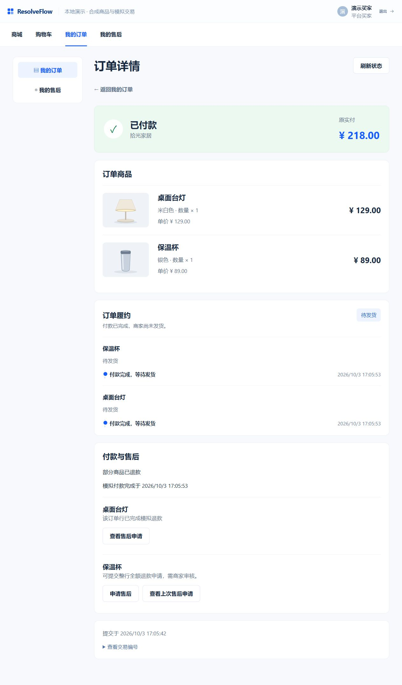

# 第六批：商城到售后集中验证

2026-10-03，依据[验收约定](../docs/marketplace-acceptance.md)，既定第六批已集中完成，复用前五批。完成状态只看tasks/todo.md顶部。两个修复fae1a5c/f11472f已正常推送；本收口提交SHA由最终回复给出，不递归修改自身提交。

## 正式浏览器结果

同一平台买家从商品/购物车按店结算、付款，继而从订单具体商品进入原售后；领取、补证问题、买家回答、人工核验、审批和撤销全部在正式网页操作，没有SQL修改工单/授权/资金或伪造回调。

| 商家/商品 | 行实付 | 处理与最终结果 |
| --- | --- | --- |
| 松间数码·耳机1件 | 329元 | demo-reviewer领取，第2版建议审批后CLOSED_SUCCESS，恰好一次329元退款 |
| 松间数码·键盘2件 | 398元 | 耳机结束后仍可申请，demo-reviewer-2独立领取审批，恰好一次398元退款 |
| 拾光家居·台灯1件 | 129元 | demo-reviewer-m2补证、回答、新调查、核验使旧建议失效、第4版再次调查和审批，恰好一次129元退款 |
| 拾光家居·保温杯1件 | 89元 | 买家主动撤销，CANCELLED、FREE槽，无授权消费/退款；修复后可进入新的空申请表且保留上次申请，未再提交 |

订单3fcea0fb-6e2f-452b-9dd3-de2aeb19ce24总实付727元、已退727元、预留0、REFUNDED；订单44684e30-461b-4737-b8f2-757931f19f7a总实付218元、已退129元、预留0、PARTIALLY_REFUNDED。订单付款事实仍PAID，履约仍真实NOT_SHIPPED，不将退款改造成物流事件。两订单模拟发货请求均409，无新增发货轨迹。

完整截图还包括[第一店全部退款](marketplace-flow/buyer-order-fully-refunded.png)、[另一行仍可申请](marketplace-flow/other-line-still-eligible.png)、[核验使旧建议失效](marketplace-flow/verification-invalidates-advice.png)、[当前调查与政策](marketplace-flow/current-investigation-and-policy.png)、[买家台灯退款](marketplace-flow/buyer-lamp-refunded.png)、[专员终态](marketplace-flow/staff-lamp-refunded.png)及[撤销后新空表单](marketplace-flow/cancelled-line-can-reapply.png)。

## 调查与材料闭环

五个指定run经AgentScope生产工厂、真实MCP读业务、本地实际dense检索钉住2026.10 R-UNSHIPPED-001、原lease/fence和回调抵达COMPLETED。18次模型决策均为mock-scripted，收费模型0；保留13条实际工具观察。耳机/键盘各读取物流与政策；台灯第2/3/4版每次额外读取真实材料引用。

材料工具仅返回引用，正文通过Java可信冻结review_context进入模型请求；已逐条核对台灯第4版实际持久request_body包含初始陈述、补证回答和人工核验三项原文，并有一轮问题及核验指向的原回答ID。客户陈述与REVIEWER_VERIFICATION分开。台灯三份授权第2版EXPIRED（请求补证）、第3版REVOKED（核验更新）、第4版CONSUMED；界面在核验后明确旧版失效，生成当前建议前没有旧审批入口。未运行修订保留两条STALE、撤销杯的一条QUEUED，预算均为空，不重置或消费。

## 集中验证与原数据

机器证据见[verification.json](marketplace-flow/verification.json)。最终67项真实HTTP读取/预期拒绝通过，覆盖跨商家工单/协作/上下文/调查404、其他客户工单/订单行404、买家私有调查403、非管理员交易403、已消费修改材料/撤销409、原UNKNOWN修改409、已退款订单发货409、三位负责人保留、当前授权/方案修订一致、行槽/账本/公开资格与终态。验证过程中拒绝请求没有业务成功写入。

对原34工单、5归属、34政策绑定、8政策、17授权、9退款操作、42订单/账本、10草稿、44行槽、45物流、85物流事件、6履约头、14账号、92run状态/version/fence及预算、1购物车条目、5旧购物车请求逐条比对所选字段保持。主要新增两次本轮购买、四工单/四行槽、三成功退款及八run，并有对应授权/负责人/事件和购物车请求；原UNKNOWN继续原operation/占用，不对账重付。原鼠标1件和原购物车请求保留；正常购物操作使两购物车头revision分别4→7、3→6，明确例外，不宣称全库未变。原始快照/购买清单仅在忽略tmp，不提交凭据、键或数据库快照。

桌面证据见[desktop-checks.json](marketplace-flow/desktop-checks.json)：专员实际1280/1440/1680均无横向溢出；买家验收时1280无溢出，订单主事实16–36px。新增的双售后按钮补足水平/换行间距，避免边框贴在一起，截图重采并复测当时尺寸。浏览器尺寸覆盖只作用于工作人员标签，买家未重新验证1440/1680，不用请求尺寸冒充实测。旧专员副标题/分区标题仍有13/15px，本批未重做其视觉系统，不宣称所有字≥16px。验收结束曾恢复尺寸、保留买家结果并关闭临时专员标签；之后环境中断使浏览器标签重建为错误页，当前可见状态不能沿用之前结论。

实际根目录命令：`agent/.venv/Scripts/python.exe scripts/marketplace_flow_acceptance.py snapshot`（业务操作前一次，拒绝覆盖），两新draft的`register --draft-id`，`inspect`，指定新line当前revision的`investigate --line-id`五次，最后`verify`（67 passed）；`pnpm --dir web test`（20文件151 passed），`pnpm --dir web build`（vue-tsc/Vite通过），新驱动定点`ruff check`/`ruff format --check`及`git diff --check`通过；`demo.ps1 status`确认3Java、只读Agent与5174运行归属。本批无Java/Agent生产代码改动，未重复前五批的实库单测矩阵或收费Live评测。

失败与修正：驱动先按误用字段sku_id/line_paid_amount、成功run SUCCEEDED、未执行run全部QUEUED、核验来源HUMAN_VERIFICATION编写，分别由实际契约/持久生命周期确认修为sku/line_amount、COMPLETED、STALE或QUEUED、REVIEWER_VERIFICATION，没有删除终态或预算断言。Ruff首轮仅导入顺序一项，定点修正。浏览器summary折叠项被按button定位导致无匹配，按实际summary DOM定位；多行同名查看按钮用明确商品/位置限定，未重提交审批。受限DOM检查parseFloat不可用，改读fontSize原字符串。终端中文显示受编码影响，UTF-8文件/页面正文正确。前端重新申请回归的首次两失败及修正见下节。

收尾期间本机Docker/全部演示进程停止，首次`demo.ps1 -NoBrowser -SkipBuild`因Docker API管道不存在失败，无数据重置。用户重新启动Docker后，同命令成功恢复3Java、只读Agent8182及5174，八政策原hash导入跳过；重启后`marketplace_flow_acceptance.py verify`再次67 passed，三退款/撤销终态、原数据与预算仍保留。旧浏览器标签当时处于错误页面，重新绑定被浏览器URL安全策略拒绝，未绕过/切换表面恢复；截图均为中断前正式验收实拍，当前体验需自行打开5174正常业务URL。

## 使用与边界

当前既定商城六批范围已接通：平台买家跨店购物→按店付款→逐行售后→有引用调查→人员最终决定→模拟退款→本人终态。日常体验沿[指南](../docs/browser-experience.md)，启动`demo.ps1 -Live`才能自动进行新调查；本轮mock验收不加入日常启动命令。不将mock工具脚本当生产固定路径，不承诺真实模型自主判断质量。未新增真实支付、库存、平台入驻/超级管理员、图片视频上传、移动端、分布式履约原子锁或跨浏览器恢复。UNKNOWN自动恢复与异常注入仍引用已有独立证据，本批只读保护原UNKNOWN，不声称本轮新注入故障恢复。

下列小步记录为实施历史，未运行/尚未完成指的是当时阶段。

## 新购物接线与金额展示修复

保留数据/只读Agent运行正常。已先采集原34工单、42订单/账本、92run/预算、14账号、八政策及物流/购物车所选字段到忽略目录tmp；正式浏览器新增两店多商品购买727/218元（耳机329＋键盘2件398；台灯129＋保温杯89），只结算选中商品，原鼠标与第二店商品在第一店结算后保留。第一店新耳机申请1997b3e9-cb8f-47a2-8e22-442208f6fe2c已提交初始文本，真实工具与本地dense政策检索经AgentScope当前revision2的精确run形成mock建议和待审授权；未扫旧队列、无收费调用或退款。网页与资金全链仍在接续验证。

联调修复三处把line_paid_amount称为“订单已付金额/订单实付”的标签，统一“本行实付”，避免多行订单把329元误当727元。App在授权PENDING_REVIEW而未领取时说明需领取/负责人审批，在上下文核对期间给读取提示，不再称“不能再次审核”。不改金额、授权或权限，仅使用既有真实归属/状态；旧缺授权和已消费文案保留。相关App金额断言改为正确语义，原测试全部保留。

实际命令：web目录`pnpm test -- --run`（20文件149 passed）、`pnpm build`（vue-tsc/Vite通过）；根目录`git diff --check`。本修复精确提交正常push；本地新增验收驱动/协议/截图仍在实施，未随文案修复夹带。未运行本批终态账本/保留数据验证、两店完整审批或Live自主性评测。

## 撤销后重新申请入口修复

2026-10-03正式网页第二店保温杯撤销后，服务端can_apply=true且保留上一申请，商城订单页却优先application而只显示查看入口。BuyerOrders改为遵循当前can_apply：可申请时显示申请售后及查看上次售后申请；不可申请时仅查看原申请。直接申请继续由CustomerWorkspace重新读资格，不增加客户端退款判断。两个新增回归分别覆盖撤销后重新申请/历史保留和已消费只能查看。

实际命令：`pnpm --dir web test -- buyer-orders.spec.ts`，首次13项有2失败（一个复现缺入口，另一个测试误把组件navigate事件当作直接hash写入）；纠正测试观察层级后13 passed。`pnpm --dir web test` 20文件151 passed；`pnpm --dir web build` vue-tsc/Vite通过。正式浏览器确认89元撤销行双入口，并进入空的新申请表单，未再提交、未新增第五个工单。集中驱动/规格/机器证据仍独立收尾，不夹带此修复。
