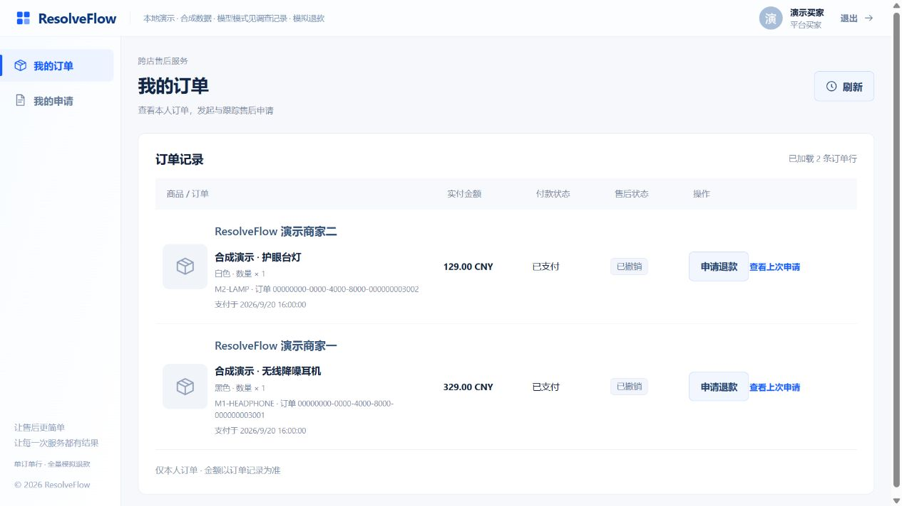
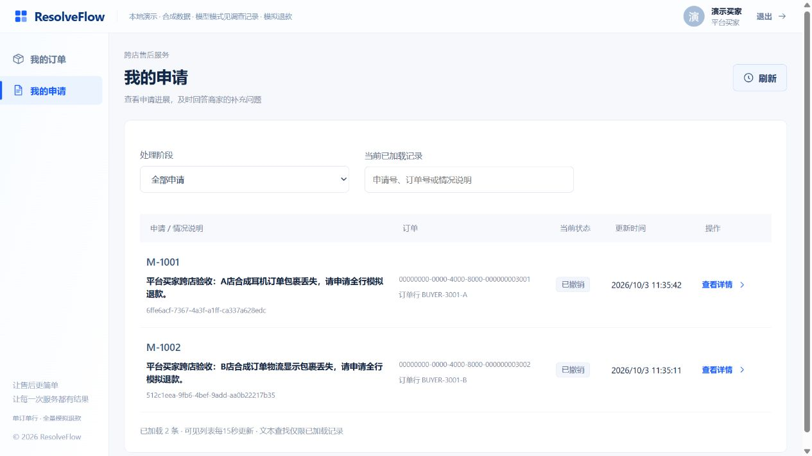

# 第一批：平台买家与跨店本人售后

2026-10-03。依据用户认可的[多商家目标](../docs/ui-marketplace-v1/README.md)和[实施对应](../docs/marketplace-implementation.md)，本批接通平台买家身份、跨店本人订单/申请与原售后操作。**商城浏览、购买草稿、付款和购物车仍由后续批次实现**；这不是完整商城交付，也没有执行退款或收费模型调用。

## 可体验行为

仓库根目录仍用`./demo.ps1 -NoBrowser`自行启动，浏览器打开`http://127.0.0.1:5174/`，新增合成账号`demo-buyer / demo-pass-4001`。同一登录看到商家一耳机329元、商家二台灯129元的独立已支付合成订单；它不继承旧客户订单。旧客户、售后专员及商家管理员账号继续可用。当前复用客户工作台，新增清楚的16px店铺标签；M01–M11商城整体页面随后续交易批次构建，不宣称已经对齐全部预期图。

正式网页先创建B店申请512c1eea-9fb6-4bef-9add-aa0b22217b35，保存本人补充文本，再撤销；A店创建6ffe6acf-7367-4a3f-a1ff-ca337a628edc并撤销。两店申请在同一“我的申请”出现，历史材料/结果保留；32900和12900分账本的已退/预留均0，无新退款操作。这两条是本次新合成记录，没有修改旧工单。B店补充材料已使旧修订run成为STALE；取消后的两条最新run仍为QUEUED，三个run的spend账均为空，沿用现有只读演示边界，不能据此宣称Agent取消清理或整条调查/审批已验收。

## 修改与隔离

- Case V24新增平台买家/可信复合映射，数据库/JWT互斥身份；同一持久登录与身份版本校验，商家管理员无法维护全平台买家。
- Case的BuyerScopes、RequestPrincipalResolver及公开订单/客户/工单入口解析真实资源归属；各店内部调用仍精确merchant/customer，不接受客户端扩大范围，不给Agent增加权限。
- BuyerOrderService每店最多取limit行，按支付时间合并，同时间跨店按merchant_id，店内保持Commerce数据库排序；分页保留各店已消费锚点，未消费店不丢行。OrderReadCursor共享微秒编码并兼容旧毫秒游标。
- 旧Commerce/public OrderLineSummary/OrderLinePage/PageMeta合同保持字面一致，平台读取另有BuyerOrderLineSummary/Page schema；响应anyOf兼容空列表，身份仍oneOf严格互斥。没有删旧断言；例子校验器扩展检查每个声明分支及平台例子。
- Commerce V9追加两个新客户的已支付合成订单、账本、FREE槽和LOST模拟物流；不代表购物/支付已实现。前端跨店显示、核心合同/fixture及专题规格同步。

## 集中验证

| 验证 | 本轮实际结果 |
| --- | --- |
| Java隔离MySQL与单元/API | 11类、95个不同测试通过、0 skipped：Shared17，Commerce19，原Case身份/客户/订单/客户端34，平台身份8、合并游标1、负责人保护16 |
| 核心协议及平台fixture | 原批135 passed＋新增空列表回归通过，共136个不同测试；保留旧协议相等/权限断言，平台混合身份/越权字段拒绝、新旧例子验证 |
| 前端 | 16文件110 passed，vue-tsc＋Vite build通过；平台买家两店展示及原账号/补证/消费保护回归 |
| 真实Gateway/Commerce/Case | [14项HTTP结果及保留数据核对](platform-buyer/verification.json)通过：微秒分页、统一本人申请、两店专员各读自己的申请/跨店404、旧客户兼容、买家不能读旧私有资源/审核、管理员人员列表隔离 |
| 浏览器 | 同一平台买家两店创建/追加/撤销与申请汇总；[1280/1440/1680布局](platform-buyer/desktop-layout.json)均无水平溢出，店铺标签16px |
| 构建/格式 | 三Java JAR重新构建并按现有保留数据启动；定点Spotless、Ruff、文档链接、JSON/YAML解析及diff检查 |

实际命令：设置`JAVA_HOME=C:/Users/hjn/.jdks/jdk-21.0.12.1+1`后，`./java/mvnw.cmd -f java/pom.xml -B -ntp -pl case-service,commerce-service -am '-Dtest=JwtCodecTest,OrderReadCursorTest,PlatformBuyerApiTest,PersistentIdentityApiTest,CustomerWorkspaceApiTest,OrderApiTest,CommerceOrderLineClientTest,OrderLineReadServiceDatabaseTest,OrderLineControllerTest' '-Dsurefire.failIfNoSpecifiedTests=false' test`；最后合并排序/补证回归用`-pl case-service -am '-Dtest=PlatformBuyerApiTest,BuyerOrderServiceTest,ReviewerOwnershipApiTest'`，其余参数同上。最终新平台8＋合并1＋负责人16通过；同一测试重复运行不重复计数。

`agent/.venv/Scripts/python.exe -m pytest agent/tests/unit/test_contracts_platform_buyer.py agent/tests/unit/test_contracts_core_routes.py agent/tests/unit/test_contracts_core_schemas.py -q`；追加空列表回归后定点该新文件8 passed，重复不计数。`pnpm --dir web test`及`pnpm --dir web build`；定点`spotless:apply/check`使用逗号分开的Java正则`.*Name[.]java`；`agent/.venv/Scripts/python.exe -m ruff check`指定两个本轮协议测试文件。运行栈两次`./demo.ps1 stop`→`./demo.ps1 -NoBrowser`保留卷/历史数据，后一次部署最终合并分页实现。实际14项HTTP/快照校验通过`agent/.venv/Scripts/python.exe tmp/platform_buyer_check.py`执行，临时脚本不属于产品依赖，持久回归在Java/Python/前端测试中。

## 数据保留与失败记录

开工时Docker引擎停止、旧PID记录无实时归属；启动本机Docker并只启动原隔离demo Compose，不清库/删卷。重启前记录旧32工单、5归属、32政策绑定、6政策、17授权、9操作、34支付账本/订单、89run、13账号。最终逐条包含核对旧工单状态/版/修订、归属、manifest/hash、授权版、操作状态、账本金钱/版、run状态/业务版/fence及账号hash/启停/两版本全部保持；最终只新增2订单/账本、1买家、2撤销工单/manifest、3个0模型调用的派发run。原始快照及hash只留忽略tmp，不提交数据库或敏感日志；[验证JSON](platform-buyer/verification.json)仅记录计数、保留结果和本次合成ID/金额。

先执行的新JWT失败回归证实旧实现拒绝无merchant_id的买家。随后发现并修复：旧控制器单测构造参数未更新；游标坏时间异常类别不统一；新增样本使“本商家所有行”旧固定断言少一行（增加新行并保留全部旧行）；管理员负例请求缺必需维护字段；MySQL3819由Spring归为DataAccess而非DataIntegrity（仍精确断言约束名）；平台字段必须分离新schema保留旧Commerce字面合同；UserProfile互斥条件、YAML局部改写缩进及新响应例子分支校验。Maven点号参数和Spotless glob/含管道正则在PowerShell/cmd解析失败，改为完整引用参数及逗号正则。真实运行旧毫秒游标的精度风险已加入微秒/同时间店内数据库排序专项，不用offset凑分页。最后运行记录核对纠正了“所有新run均QUEUED、spend为整数0”的诊断假设：实际旧B修订STALE、两条最新QUEUED，spend为JSON空账；正确类型/状态再次核对通过。上述失败均重跑相应验证通过，没有降低领域断言。

本轮未跑全仓矩阵、全量Agent质量评测、真实模型调查、新付款/多行退款/未发货政策或完整商城视觉验收；不重复旧售后五批验收。本批之后接商品目录、店铺、规格/数量、服务端报价及独立待支付草稿，再按既定顺序接模拟支付和购物车；不恢复CXX/C12。

