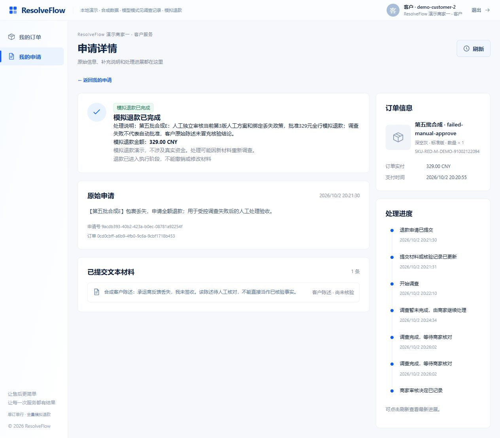

# 第五批：正式网页整体验收

日期2026-10-02。按已批准的新五批计划及v2交互合同执行，复用前四批真实页面和服务。此次在正式5174网页集中验证3位客户、4位售后专员、1位商家管理员、两逻辑商家及独立失效会话。五条新增申请均已结束：三笔329元模拟退款、一笔拒绝、一笔撤销。未收费调用模型；mock只证明流程与保存/引用链路，真实模型既有证据见[审查收尾](reviewer-completion.md)，不能据此宣称正确率提升或生产完成。

## 实际流程与结果

| 场景 | 网页行为及观察 | 最终验证 |
| --- | --- | --- |
| A：补证与核验 | 客户一从新订单申请并提交材料；两专员打开同协作版领取弹窗，一人成功、一人冲突。专员一要求具体补证后转交专员二；客户回答自动关联当前问题。rev2→回答rev3→核验rev4，每版定点mock调查，旧建议失效后不可沿用审批。专员二阅读绑定丢失政策原文和例外，审批当前rev4 | CLOSED_SUCCESS；32900分；operation 9ce95572-0ceb-4933-8dee-6ede7fe82691，恰好一个SUCCEEDED；客户可读问答、核验及公开结果 |
| B：接管与拒绝 | 客户二申请；两专员旧版领取冲突明确显示。专员一先打开转交弹窗，管理员在自己页面明确接管；旧负责人提交原转交409，不能覆盖新owner。管理员读取mock建议后人工拒绝并填写公开理由 | CLOSED_REJECTED；退款0、预留0；客户可读公开拒绝理由，刷新重新登录保留本人详情 |
| C：商家二 | 商家二客户申请，仅本商家队列可见；专员一领取后转交专员二，目录只有本商家可用工作人员；专员二审批绑定商家二政策。商家二查询A返回404 | CLOSED_SUCCESS；32900分；operation 04f3efad-6b5b-48d9-afb9-d5d8e528acaa，恰好一个SUCCEEDED；客户和工作人员历史均可读 |
| D：撤销 | 客户一新建另一申请，在允许动作中填写理由撤销，没有调查或人工批准 | CANCELLED；退款0、预留0，无客户写入动作 |
| E：失败人工闭环 | 客户二申请及原始陈述；专用mock读到已保存的LOST物流后耗尽脚本，异常留下RUNNING。真实active deadline到期后以同run租约/fence和生产RunWorker失败分支落库BUDGET_DEADLINE。负责人网页提交引用原材料/绑定政策的HUMAN方案rev3，未自动批准；重新登录仍是待审授权。单独审批后退款成功 | CLOSED_SUCCESS；32900分；operation 4da5098e-e76a-4520-8665-9c4161d6767b，恰好一个SUCCEEDED；客户材料仍标尚未核验，不变成模型或人工事实 |

工单/订单行/修订/run、公开结果、金额与原记录摘要保存在[合成验收JSON](product-flow/acceptance.json)，可查询编号见[浏览器指南](../docs/browser-experience.md)。数据库与原始敏感日志不入Git。

所有创建、提交材料、补证问题/回答、核验、领取、转交、接管、批准、拒绝及撤销都从正式网页操作。辅助脚本只给新增专用订单准备既有Commerce合成数据、做读检查及精确run的mock调查；没有SQL修改工单、授权、run终态或付款结果。失败恢复经过真实租约与fence/Outbox，不构造冒充成功的回调、不延长deadline、不重置预算、不启动全队列消费。

## 边界与旧数据

- 最终48项Gateway请求通过：五申请的跨客户详情/订单行及跨商家工单、归属、审核上下文、调查返回404；三成功申请消费后材料/撤销409；原UNKNOWN材料/撤销409。
- 独立合成账号synthetic-flow-d2005746386f经管理员API创建v1、停用v2；旧有效会话401，停用后正确密码登录401。浏览器空闲读取也退出并显示登录失效。该账号保持停用；未改变种子凭据。旧停用账号错误密码401只是辅助请求，不冒充正确密码校验。
- 退款账本：三个成功行各32900分已退款/0预留，拒绝与撤销行0/0，全部不超过原支付额32900分；同成功行仅一个操作。原UNKNOWN ce263102-965d-4dee-974f-351c9800b5cb保持RECONCILING，原operation 0bc48b1b-d9e1-4ca4-947f-995524f68979及资金占用未变，没有重付。
- 追加前历史快照与最后验证逐ID一致：27工单status/version/input_revision/updated_at、1归属、27政策绑定、6政策bundle/hash、11授权、6退款操作、29支付账本和78条run状态/version/fence保持不变。摘要在JSON；原值只保存在忽略的tmp/product-flow-baseline.json，不提交数据库快照。

## 集中验证命令

| 本批实际命令 | 结果 |
| --- | --- |
| `pnpm --dir web test` | 最终109 passed，16 files；另`pnpm --dir web build`类型检查/构建通过 |
| Java21 `java/mvnw.cmd -f java/pom.xml -B -ntp -pl case-service -am -Dtest=CustomerWorkspaceApiTest,CaseCollaborationApiTest,ReviewerOwnershipApiTest,StaffAdminApiTest,ReviewDecisionApiTest,ReviewedEvidenceApiTest,ManualProposalApiTest -Dsurefire.failIfNoSpecifiedTests=false test` | 84 passed，0失败/跳过，BUILD SUCCESS；分别8/11/16/11/11/9/18 |
| `agent/.venv/Scripts/python.exe -m pytest agent/tests/unit/test_product_flow_driver.py agent/tests/unit/test_reviewer_demo_driver.py agent/tests/unit/test_contracts_core_routes.py agent/tests/unit/test_contracts_core_schemas.py agent/tests/unit/test_contracts_core_reject.py -q` | 最终189 passed；新驱动19项保护覆盖他人工单/重复目标、非当前QUEUED修订、结束/消费状态、非专用失败目标及未到真实deadline拒绝恢复 |
| `agent/.venv/Scripts/python.exe -m ruff check scripts/product_flow_acceptance.py agent/tests/unit/test_product_flow_driver.py` | 通过 |
| `agent/.venv/Scripts/python.exe scripts/product_flow_acceptance.py boundaries`及`verify` | 最终48请求及五终态、三单次退款、历史快照保护通过 |
| `.\demo.ps1 status` | 真实归属本驱动的case8183、commerce8181、gateway8180、只读Agent8182、前端5174均运行；本批未开启Live |

脚本先`inspect`发现manifest内申请，再仅`investigate --case-id <manifest内仍QUEUED的工单>`；正常终态拒绝重跑。`recover-failure`只限E的同修订RUNNING且真实deadline已到、租约可回收的run。`seed`不重配已有manifest，`seed-failure`不可重复；这是本机验收辅助，不是通用数据重置/全队列工具。新克隆没有本机基线及五记录，应自行通过产品体验，不凭JSON宣称本机验收通过。

## 发现与修复

1. 同版领取冲突后父层null→新owner刷新清掉错误。回归先1 failed/2 passed；修复后提示跨同工单刷新保留，切换身份/工单清除，见[修复记录](collaboration-feedback.md)，11cbd59已正常推送。
2. 明确退出仍保留客户详情hash，另一账号登录先404。回归先App1 failed/15 passed；修复后退出清私有路径，正常刷新重登保留本人详情，见[修复记录](account-route-boundary.md)，b30e300已正常推送。
3. E的人工理由仍在三层依据标题下被称为Agent解释。回归先1 failed/14 passed；按持久HUMAN origin修正，109测试/build通过，见[来源标识记录](human-proposal-label.md)，1772597已正常推送。网页复核显示“人工方案理由与适用判断”。

验收自身失败如实保留：E耗尽mock脚本抛AssertionError，初轮并没有形成FAILED回调，不能记作通过；使用实际过期后的同run保护恢复再完成网页人工闭环。五次成功mock及失败恢复的已保存结果分别记录；成功finish当时为CALLBACK_PENDING，回调送达后的最终run为COMPLETED。停用账号API初次缺display_name/role返回422，补齐现有合同后通过。辅助verify初轮SQL列名、脚本Ruff格式/导入及浏览器定位猜测错误已纠正，没有改约束绕过。多标签下第一次尺寸变更未实际生效，未计入桌面结果；关闭干扰标签后按实际DOM尺寸重新保存。最终144个本次入口/账本/报告文档链接存在，验收JSON未包含token/key或密码值，Git diff检查通过。

## 视觉与证据

沿用v2角色/布局/白蓝风格及真实状态，不按生成图添加媒体、画像或假额度。第五批客户详情实际viewport1280/1440/1680，documentWidth分别1265/1425/1665（滚动条占位），无横向溢出；见[尺寸记录](product-flow/desktop-checks.json)。第四批已经检查管理员及商家桌面布局，本批复用，不冒充第五批重新全页面像素验收。

| 截图 | 证据 |
| --- | --- |
| [客户补证与成功1440](product-flow/customer-success-1440.jpg)、[1680](product-flow/customer-success-1680.jpg)、[1280](product-flow/customer-success-1280.jpg) | A原始记录、回答与结果及桌面尺寸 |
| [领取冲突](product-flow/claim-conflict.jpg)、[旧负责人](product-flow/old-owner-conflict.jpg) | 刷新后明确错误、原提交拒绝 |
| [重新调查](product-flow/reinvestigation.jpg)、[工作人员结果](product-flow/reviewer-success.jpg) | 核验后旧建议失效及最终执行 |
| [商家二客户](product-flow/customer-m2-success.jpg)、[商家二历史](product-flow/merchant-two-history.jpg) | 双商家流程/公开结果 |
| [客户拒绝](product-flow/customer-rejected.jpg)、[失效会话](product-flow/session-expired.jpg) | 人工理由与401退出 |
| [失败待人工](product-flow/investigation-failed.jpg)、[人工审批成功](product-flow/manual-success.jpg)、[客户公开成功](product-flow/customer-manual-success.jpg) | 失败→人工方案→独立审批→执行结果 |

## 完成范围与未运行

新五批在个人项目桌面演示范围内已交付并通过相应批次验证。完整链路是客户申请→工作人员明确负责→原始信息/Agent和RAG依据→补证或人工方案→独立审批→Java模拟执行→客户公开结果。界面不是19张图逐像素复制，图中弹窗/状态板不另建绕过权限的路由。

本批未运行收费Live、完整Python/全仓矩阵、旧过期golden包、未提交Commerce他人资金测试、真实支付、公网部署、媒体上传或移动端；既有8K上下文保护仍可能把长材料转人工，未承诺解决所有模型质量问题。E是受控脚本崩溃加真实deadline恢复，不证明所有生产异常即时自动转人工。人工方案后当前材料版无Agent调查，原失败信息仍保留在run/轨迹；当前界面不提供所有历史run切换。D取消后的派发记录仍QUEUED（本批只读Agent不扫队列），不宣称所有排队记录已经清空；Case已CANCELLED、写入动作为空、资金0，本辅助驱动禁止消费结束工单。公开时间线沿用通用事件文字，人工方案可能显示“调查完成，等待商家核对”，不据此声称Agent生成了该方案。后续用户提出新的范围再继续，不自动启动另一套路线。
