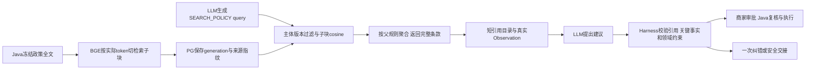

# RAG语义验证、生产接入及Agent对照

2026-10-06完整批次，统一交付。语义诊断、生产代码接入、真实Agent对照与统一报告均已完成；本批当时的人审与原Docker部署仍有明确未完成项。之后用户恢复Docker，部署与真实业务闭环见[追加部署报告](../rag-deployment/README.md)，下文保留原实验环境与当时未运行事实，不覆盖原结果。当前状态只在tasks/todo.md顶部维护。核心证据：[整体Agent对照](agent-comparison.json)、[政策语义覆盖](policy-semantic-coverage.json)、[评估员来源核查](judge-source-audit.json)、[实际调用与用量](usage-summary.json)。

本批复用原文冻结、结构保留、66个无截断子块与29个冻结问题，不改Gold或排名。生产已经有ReferenceCatalog短引用，本次外部文档短包是独立实验：正文/必要上下文相同，只把重复来源证明留在可信账本。116组回查通过；前5项完整JSON相对去重但带完整元数据的实验包减少dense73.93%、BM2574.73%。这是实验包的开销，不是生产首轮/整个Agent token节省。

## 语义质量的证据与缺口

模型在不见排名/作者Gold的情况下，读取范围内完整来源，标出回答需要的原文块。固定DeepSeek Flash，真实请求、用量和拒绝响应均留存；最多一次格式/引用修正，不按题目改规则。22/29份判断通过协议/来源校验，7份失败保留。其中18题需要政策依据，4题需补充事实/无依据；前2项全部依据覆盖dense11/18、BM2513/18，前5项均18/18。见policy-semantic-coverage.json。这个结果不是人工Gold；同模型作评估员有相关偏差，小样本/FAQ并非真实买家日志。独立人审0，正式准确率仍null，不能宣称“检索完美”。

第一次SDK消息构造失败实际0请求，却误增29计数，已按请求记录更正并保留semantic-preflight-audit.json和原失败报告。v2实际29请求、5通过、24协议失败；另1次调试请求；v3实际50请求、21通过、8失败。最终把非决定性的uncertain字段改为可缺省null，mandatory类别/引用/三维评分不放宽；仅重验保存响应，22通过/7失败、无新增请求。合计80真实语义请求；v2失败中的24次用量未完整留存，不能捏造全批token总数。v3全50次用量保留。

## 生产接入

`PolicyIndex.build`自动使用真实encoder的子块构建能力；追加012迁移，完整父条款保留权威引用，子块只作检索。真实BGE/PG探针：1501 token条款→4子块，最大380，返回完整条款/尾部例外/hash；超长query拒绝。子块错位、文本/向量篡改、父引用变造或READY数量/指纹不一致均拒绝，不静默BM25降级。generation映射只捕获一次，重建后旧run仍用原代；旧代失效拒绝替换。多bundle身份绑定完整映射。新增变更没有政策修改/审批/退款权限。

原Docker因dockerInference套接字启动失败，自动审批拒绝强制结束/删除套接字；正常desktop stop也失败。为继续验证，按PostgreSQL官方提供的[Windows ZIP入口](https://www.postgresql.org/download/windows/)使用[EDB二进制](https://www.enterprisedb.com/download-postgresql-binaries)，临时本地16.15/127.0.0.1:55434/新agent_db。精确下载/hash见runtime-environment.json，仅本地SHA，未声称供应商checksum验证。原卷/业务数据未触碰，无全局安装或服务。本地首次BGE探针fsync开启；后续隔离测试关闭fsync/synchronous_commit以降低临时测试I/O，不验证断电持久性；SQL事务/逻辑恢复/fence仍为真实PG。没有部署到原Docker业务服务。

## 集中验证与中间失败

实际命令和模块在commands.json，报告固定不覆盖。最初扩大到整个历史agent/tests的运行中断，仅观察到8个失败，无完整统计/根因归类，不能说全项目通过。第一次相关集中回归785通过/15失败：14个旧回放源码不兼容，1个政策hash_mismatch诊断回归。另一次在代码/配置最终固定前开始的785/15保留。诊断回归已修复，原断言保留；当前重新记录rag-delivery-v13十四包并逐一strict MATCH。v11/v12是开发过程中真实保存的中间包，现源码不接受其manifest，不冒充当前回放。v13导出曾因并行隔离DDL目录扫描遇到relation OID消失而13通过/1错误，只顺序补录缺的1包；后续PG验证顺序执行，不修改旧迁移。

当前代码Ruff/diff通过；mypy仍16个既有诊断/9文件/75源码，无新增错误但全项目类型门禁未通过。Harness28/28；相关单元/索引集成及真实BGE探针已过。最终相关集中回归800 passed/0 failed/errors/skipped（137.12秒，1个既有AnyIO弃用警告），见tests-accepted.xml；与中间失败报告分开。Docker OS级strict隔离、Java整链/网页、日常run消费均未运行。

## 整体Agent对照（实际完成）

历史32例基线可复用：开工时生产harness/policies/tools与旧报告所有记录hash一致，只有未加载进Agent的离线rag_probes变化，证据baseline-provenance.json。原31/32联合达标/31完成/1未完成，158真实请求、provider input273381/output18588。新32例沿用同输入/Gold/模型参数/12次配置/入口，不重复付费跑另一份before；新RAG工程路径是运行变量。业务读来自合成loopback HTTP/MCP，真实SDK/PG/BGE/LLM，不是Java端到端或真实客户流量。新建议会匿名X/Y逐份做事实、政策适用和动作理由一致性检查，不给未完成候选捏造评分，不宣称独立人审。

新32例完成，报告状态FINISHED，退出1：31联合达标/31完成/1未完成，0调用错误/0接受禁止终局，165实际模型请求，provider input289906/output21516（165/165均有非估算usage）。原31/32/158及input273381/output18588不是缺失的before，冻结hash已核实且开工源码一致。自动联合率没有提高，调用量和token未减少；不宣称RAG提升整体质量或效率。完整逐例与实际请求见agent-live.json，对照见agent-comparison.json。

| 项目 | 历史基线 | 本次 |
| --- | --- | --- |
| 自动联合达标 | 31/32 | 31/32 |
| 完成/未完成 | 31/1 | 31/1 |
| 实际请求 | 158 | 165 |
| provider input/output token | 273381/18588 | 289906/21516 |
| 接受禁止终局 | 0 | 0 |

A03B本轮正确选择人工复核；A15B从基线可用建议变为未完成。后者在review_findings把单一来源写成CONFLICT，违反“冲突须有两来源”结构约束，Harness给一次定向反馈；模型随后ESCALATE而非修正建议，6次调用后安全交接。没有耗尽12次预算，也不是RAG召回失败；保留失败，不通过为A15B写模板或加调用次数追32/32。A07B/A14B从人工复核变为补证，均在原Gold许可内；不把动作不同都当回归。

匿名X/Y语义对照32组共34次真实请求，30组协议有效/2组失败。完成候选各30份有有效评分：模型判baseline三维全过29/30、candidate30/30；两组失败均因评估员给未完成候选写false分数，最多一次格式修正后仍重复，因此两组整体未纳入评分，没有把未完成候选算质量差/好。原响应与拒绝详情完整保留。评测员还误判baseline A10B的INCONCLUSIVE缺来源：它漏看已注入且已在评分输入中的冻结ReviewSnapshot，而get_case_evidence引用的版本/hash与该核验材料匹配，首轮实际请求也包含此枚举。见judge-source-audit.json；这是Codex来源核查而非独立人审，原模型评分未改，**不得用29/30→30/30声称语义提升**。这证明模型评测员本身也需要来源校验与复核。

本批实际新增请求279（政策语义80＋新Agent165＋匿名语义34），ledger474→753，limit=null，不重置旧费用账本。新Agent及匿名评估的全部199次provider usage齐全；匿名评估input198849/output6062。政策v2中24次缺完整usage，故全批token总量null，不补造真实计费或费用，见usage-summary.json。

真实运行固定工程提交4c1b67e；evals/rag-delivery-v4/manifest.json冻结34生产文件与入口/原数据/预算；live-freeze-audit.json核实整个live期间未改运行源码或入口。真实对照与匿名评分结束后，才更新eval入口默认回放至rag-delivery-v13并注册14包完整数：新入口58相关测试通过、正式CLI strict14/14、Ruff/diff通过。与主集中800相比新增3指标测试＋2新profile缺包负测，即805个不同相关用例；不是整个历史项目测试目录通过。final-entry-audit.json记录这一不影响生产循环的后置入口差异，受控真实重现使用4c1b67e。

临时PG已正常停止，数据目录保留；无活跃其他查询，中断的整个历史目录运行留下1个临时schema，保留作诊断而不声称全清理。原Docker仍未恢复，原业务服务没有重启/部署、未消费QUEUED/退款或改政策。runtime-close.json记录环境收尾。

实际命令：

```powershell
# 本批实际已跑完，重复执行会再次收费；正常质量核验优先查看保存报告
./eval.ps1 -Mode live -Case $all32Ids -ModelCalls 12 -Dataset evals/calibrated-v3 -Output reports/rag-delivery/agent-live.json -LiveUsage tmp/evaluation-live-budget.json
agent/.venv/Scripts/python.exe -m scripts.evaluation.semantic_review agent --baseline reports/agent-live-harness-baseline/live-baseline.json --candidate reports/rag-delivery/agent-live.json --output reports/rag-delivery/agent-semantic.json --cache-output tmp/rag-delivery/agent-semantic-private.json
agent/.venv/Scripts/python.exe -m scripts.rag_delivery_compare --baseline reports/agent-live-harness-baseline/live-baseline.json --candidate reports/rag-delivery/agent-live.json --review reports/rag-delivery/agent-semantic.json --output reports/rag-delivery/agent-comparison.json
# 当前入口无收费、无网络业务读取
./eval.ps1 -Mode replay
```

这里$all32Ids来自calibrated-v3/agent/cases.json全部ID；实际使用临时PG的环境在commands.json。固定报告不覆盖，需复跑时新输出文件；保存的原始官方页面/完整引用账本/语义源审请求在忽略的tmp，不提交版权原文、API密钥或数据库文件。冻结policy语料依然是参考资料，商家政策采用映射及独立标签需要后续确认。本批完成到用户要求的整体对照，没有自动开始hybrid/rerank、商城/前端修改或下一轮付费评测。

## 可迁移的经验与取舍

| 现象 | 根因与处理 | 验证及边界 |
| --- | --- | --- |
| 长条款尾部可能没进embedding | encoder会默认截断；先用实际tokenizer切检索跨度，完整父条款保留权威身份 | 1501 token原文全部重建，4子块≤384；这个探针证明完整性，不是语义准确率 |
| 来源证明占用上下文 | 同来源URL/hash/定位字段重复；模型用短ref，系统保留可信ledger再精确展开 | 116固定信息集回查；账本hash必须由系统保存，不能采信模型自带hash；实验节省不冒充生产收益 |
| 索引重建可能使调查中途换代 | 只按“当前最新READY”读取不等于锁定run；捕获全bundle映射，聚合进入manifest，搜索只读精确代 | 重建后旧run仍读旧代、失效则拒绝；恢复不跳代，未就绪不自动借新代 |
| 格式合法和建议正确容易混淆 | 引用存在只是必要条件；另做完整来源适用标注与匿名事实/政策/动作一致性审查 | 来源/mandatory协议严格、辅助uncertainty缺失保持null；同模型裁判仍有偏差，独立人审0 |
| “自己出题自己答”分数过于理想 | 冻结官方原文/独立问法来源，不向标注员展示排名和作者Gold，再评分实际来源覆盖 | 11FAQ并非买家日志、18题为合成，不能称真实holdout；7协议失败不从29分母消失 |
| 并行验证看似互不影响 | 隔离schema仍共享PG catalog，旧迁移读取约束定义与另一schema删除发生竞争 | 保存13/1实际失败，顺序补缺；本批不修改旧迁移或宣称多环境并行DDL可靠 |
| API计数先增但请求没发出 | SDK输入构造在client之前失败；前置消息构造/prepare校验，按真实请求记录核实 | 29本地失败0发送的审计与计数调整保留；未保存usage不补造账单 |

生产路径（评测工具不参与审批）：



检索跨度是工程手段，政策条件仍由完整规则、来源及领域硬约束决定。模型判断辅助人审；本批没有把评测失败转成特例词表、为每题写固定query，或因看过test结果启用hybrid/rerank。
