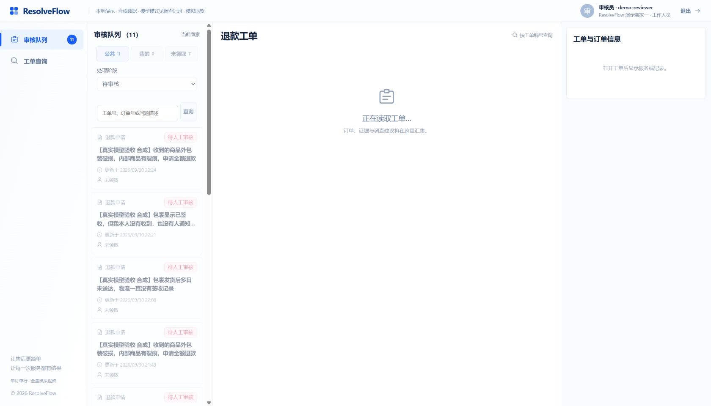
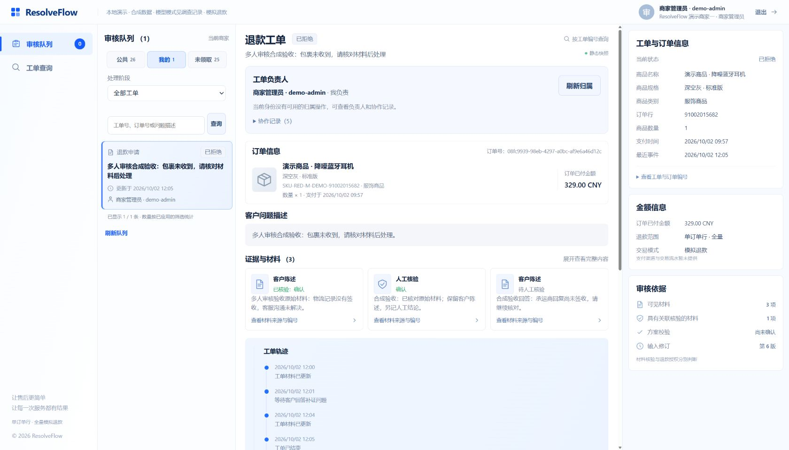
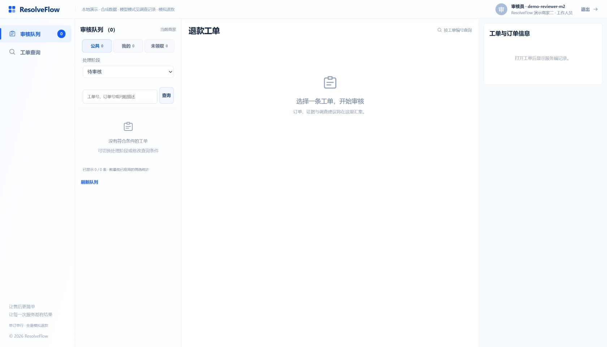

# 多人审核：归属队列与真实计数

2026-10-02。按[v2实施合同](../docs/ui-targets-v2/README.md)和[第三批计划](../tasks/plan.md)接续已有归属保护，完成公共／我的／未领取队列、负责人和数据库计数。下一执行点只看[todo顶部](../tasks/todo.md)，人员管理仍未实施。

## 可演示行为

- 正式商家网页明确发送scope/view/query，读取当前账号本商家的工作区；阶段与归属独立。每行显示持久负责人，停用负责人不自动变成未领取。
- 标题显示全部匹配数，页尾显示已加载数／匹配数，三种归属数与阶段数由同一个数据库快照计算。分页加载不会把20条当成总数；搜索未提交的草稿不会改变下一页请求。
- 搜索按工单／订单精确编号或描述包含文本，`_`、`%`不是通配符。微秒keyset游标绑定商家、账号、阶段、归属和已应用搜索；更换筛选后旧游标400。分页合并按ID去重，退出后迟到成功或失败不污染新会话。
- 无工作区参数的旧待审缓存入口、Redis降级与限流保留。该兼容入口不提供权威归属或计数，不能据其owner=null判断未领取；正式网页不走它。
- 沿用领取／转交／接管及人工权限；本次没有改变领域状态、授权、输入修订、调查或付款路径。跨会话归属仍须刷新或冲突读取，没有主动通知。

文件：CaseRepository、ReviewQueueService／Cursor／Controller及ReviewQueueApiTest；App.vue、client.ts、workbench.css、ReviewIcon.vue及app.spec.ts；核心OpenAPI／路由说明、[队列fixture](../contracts/core/fixtures/review-queue-workspace.json)与协议回归、[协作规格](../docs/case-collaboration.md)。不追加数据库迁移，不改变依赖锁。

## 实际验证

Java命令均先设置`JAVA_HOME=C:/Users/hjn/.jdks/jdk-21.0.12.1+1`，其余从仓库根目录执行。

| 实际命令 | 结果 |
| --- | --- |
| `java/mvnw.cmd -f java/pom.xml -B -ntp -pl case-service -am -Dtest=ReviewQueueApiTest,ReviewQueueCacheTest,ReviewQueueBackpressureTest,RedisReviewQueueCacheIntegrationTest,CaseCollaborationApiTest,ReviewerOwnershipApiTest -Dsurefire.failIfNoSpecifiedTests=false test` | 6类46 passed，0失败／跳过；队列11、协作11、人工归属16、Redis4、缓存2、限流2 |
| `java/mvnw.cmd -f java/pom.xml -B -ntp -pl case-service -DspotlessFiles=.*CaseRepository[.]java,.*ReviewQueueService[.]java,.*ReviewQueueCursor[.]java,.*ReviewController[.]java,.*ReviewQueueApiTest[.]java spotless:apply spotless:check` | 本步5文件实际格式化并通过；匹配到的CustomerCaseRepository未变化；首次不带路径模式的命令未格式化目标，不将其记为格式通过 |
| `agent/.venv/Scripts/python.exe -m pytest agent/tests/unit/test_contracts_core_routes.py agent/tests/unit/test_contracts_core_schemas.py agent/tests/unit/test_contracts_core_corpus.py -q` | 169 passed；包含新队列fixture、非负计数、owner不泄露hash、未领取version=0及旧核心兼容 |
| `agent/.venv/Scripts/python.exe -m ruff check agent/tests/unit/test_contracts_core_routes.py` | passed |
| `pnpm --dir web test`、`pnpm --dir web build` | 最终88 passed，14文件；vue-tsc＋Vite build passed |
| `.\demo.ps1 status`、`.\demo.ps1 stop`、`.\demo.ps1 -NoBrowser` | 先核对五进程ours；保留卷停止，三个新版JAR构建、现有政策导入跳过、索引READY、只读Agent／Gateway／Case／Commerce／Vite启动通过；未使用-Live |
| `agent/.venv/Scripts/python.exe tmp/queue-api-check.py before`、`... after` | 启动完成后取现有数据基线；4账号×6阶段×3归属共72组，数据库逐项对照全量计数、逐页ID／负责人／协作版；搜索另一商家ID为空，客户队列403。临时脚本仅作读验收，产品运行不依赖它；[保存的API证据](reviewer-queue/api-acceptance.json) |
| 正式浏览器，现有账号登录／筛选／分页／搜索／切换角色商家 | 公共待审11；全部20／26→26／26；未领取全部25；专员我的待审0；管理员我的全部1，显示原负责人demo-admin；精确ID搜索1；搜索草稿不破坏分页；商家二待审0且旧详情清空。[浏览器记录](reviewer-queue/browser-acceptance.json) |
| 浏览器1280／1440／1680桌面 | 页面无水平溢出，三个筛选按钮可达；[尺寸记录](reviewer-queue/desktop-layouts.json)。检查后重置临时viewport |
| `git diff --check`、精确暂存后`git diff --cached --check` | 交付时执行，结果以当前记录／提交收尾为准 |

读验收不新增或领取工单、核验、审批、重置账号、退款或调用收费模型。27条既有工单及其状态／业务版本／修订／归属／协作版，在启动后的基线与API、浏览器检查结束之间保持不变；不将它称为启动前数据库快照或全库无写入。只读启动仍执行既有幂等政策／索引准备。

## 失败修复与边界

新增关键Java回归首轮2项未通过（旧接口缺counts、新筛选游标仍200）；前端首轮新回归失败（标题显示1而非服务器45），均保留断言后实现修复。实现中误用了principal.username导致编译失败，改为现有subject；一次临时Python读取漏UTF-8再次未修改成功，随后修正。兼容行新增公开owner字段后原精确字段集合失败，按同步后的契约增加该字段断言并继续检查legacy不提供collaboration_version，未删除原断言。

协议首轮3项失败：测试误将CORE_DIR字符串当Path、描述遗漏权威docs／PENDING_REVIEW；修复路径、描述和新增scope参数的精确集合后169项通过。追加路径使Ruff出现1条超长行，已拆分并复跑。验收脚本首轮未指定case_db、一次PowerShell替换转义错误，均修正；可比较的数据基线是在新版启动后重新读取。第一张截图工具返回JPEG字节但暂用PNG扩展，已改为实际JPEG文件；未编辑图片内容。视觉检查发现悬停背景盖住选中按钮文字，定点修复并重新截图。最后补充搜索草稿／已应用搜索分离，经88项测试和真实浏览器复核通过。

本次未跑Java全仓／资金模块、Python Agent全套／live评测，也未重跑前一批完整退款闭环；队列读改动采用上述针对性验证，不继承历史通过当本轮通过。人员创建、启停、角色维护、重置及审计、最后管理员保护、管理菜单仍是下一子步；第四批概览／政策与第五批整体网页验收未完成。

## 正式网页截图

