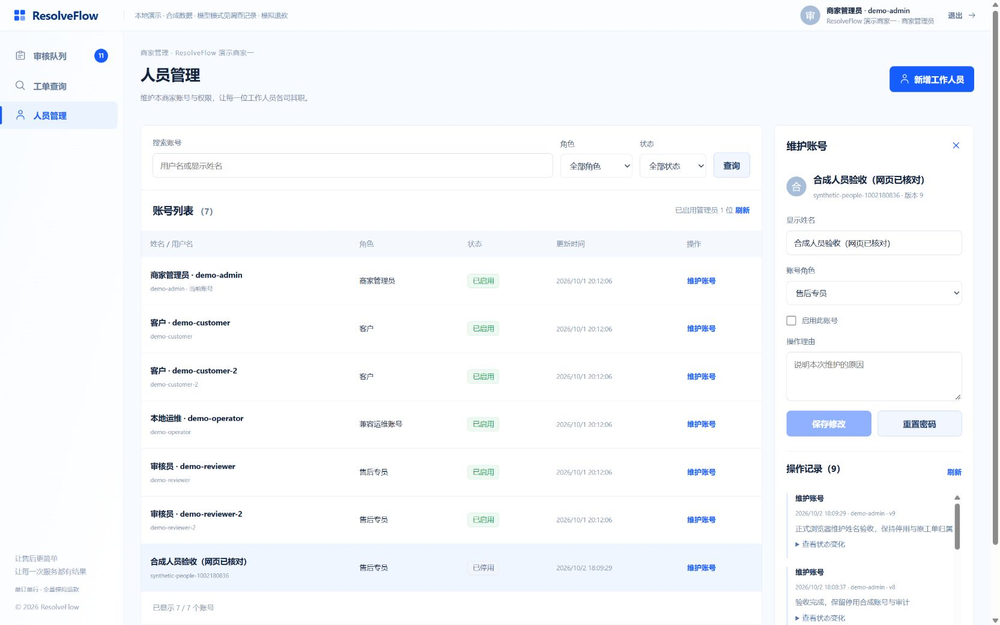

# 第三批：本商家人员管理

2026-10-02，按已批准多人协作方案及v2人员页实施。账号维护复用持久身份，不改变工单负责人、输入修订、金额或Agent权限。

## 后端子步

- 新增人员列表/真实筛选计数/绑定游标、新增工作人员、姓名/角色/启停维护、密码重置及账号审计，共5条Case核心路由，29→34。V23只追加账号维护版本和审计表；username及merchant/customer固定。
- 写事务按商家→有序账号锁序；锁内当前读校验签名身份与目标维护版，商家锁保证最后启用管理员检查与变更原子。PBKDF2随机盐计算在短事务前，凭据不回读、不进入审计。姓名变化不杀会话；角色/启停/密码增身份版，重新启用不复活旧token。
- `StaffAdminApiTest`先7项红灯（正式路由尚不存在，404），实现后7项通过，再补并发/等待锁签名撤销/读取快照过期及禁用保留负责人，共10项通过。两个管理员并发停用仅一个成功；旧版本写入不覆盖已提交状态；新工作人员真实登录并领取工单，禁用后负责人/工单版本/输入修订保留。
- 实际命令：Java21下`java/mvnw.cmd -f java/pom.xml -B -ntp -pl case-service -am -Dtest=StaffAdminApiTest -Dsurefire.failIfNoSpecifiedTests=false test`；最终`... -pl case-service -am test`。shared-kernel 62 passed；case-service 314 passed、4 skipped、0失败/错误。4项既有跳过未宣称通过。
- Spotless对新Service/Controller/测试及ApiExceptionHandler精确正则运行apply成功。核心契约同步，新增fixture验证凭据泄漏/跨主体字段/非法新增角色及原账号版本。第一轮合同生成锚点与旧YAML重名，修复为独立名称；随后2项新测试误用ValidatorBundle方法，修正后`pytest agent/tests/unit/test_contracts_core_routes.py -q`为78 passed。一次误指定不存在测试文件导致零步骤失败，已纠正，未记通过。

## 人员页与批次验收

- `AdminPeople.vue`接正式分页表格、姓名/角色/启停维护栏、操作历史、新增与重置对话框。管理员独有菜单放在共用商家外壳内，回到队列重新读取当前状态与SSE；售后专员保持原工作台。409保留非密码草稿并要求重新打开账号核对原版本，不自动按新版本重发；网络结果未知不自动重试。密码在提交/关闭/离开页时清空，自身安全变更后立即退出。通用弹窗键盘陷阱包含select、排除disabled字段。
- `pnpm --dir web test`最终99 passed（15文件）；`pnpm --dir web build`类型与打包通过。11项新增测试覆盖筛选及真实总数、打开时版本/409草稿、创建密码清空、自身会话失效、迟到审计、网络未知、角色导航、客户端版本头和键盘访问。初次构建发现游标可为null，规范为undefined后通过。
- Python全部`test_contracts_*.py`为557 passed、16 skipped。后续对人员专用游标补256长度约束（120字符username的合法游标长204，旧通用参数200不适用），核心路由78 passed、新API专项11 passed。全量Java结果来自该游标小改前，游标变化后只针对相关11项复测；不把重复运行累加为独立测试数。
- `demo.ps1 status`确认所有进程为本驱动，再`demo.ps1 stop`/`demo.ps1 -NoBrowser`保留数据构建新版三个JAR/健康启动。V23在原演示库追加成功、现有政策6份均跳过重复导入；Agent保持只读，没有开启Live、新调查或退款。前端保持5174，Gateway8180。
- 正式Gateway合成验收28项，加网页维护后2项复核，见[去凭据记录](staff-management/verification.json)：M-1001账号6→7，额外账号`synthetic-people-1002180836`先新增/登录，显示名维护保持旧会话有效，再重置、停用、重新启用、提升角色、自我降级；旧token均按合同401，重新启用不复活旧会话。最终保留停用REVIEWER、维护版9和9条审计，不改种子账号密码/角色/启停。不删除账号/审计数据。
- 正式浏览器完成合成账号姓名维护并出现保存确认/新版本/新审计；角色＋状态联合筛选（停用专员1/启用专员2）、空列表0、最后管理员角色/停用控件禁用；售后专员菜单无人员管理；M-1002仅5个本商家账号且清空M-1001详情。1280/1440/1680桌面无文档或表格水平溢出，复选框16px、文字同行；发现公共表单CSS覆盖后定点提高人员页选择器并复核。新增和重置对话框可正常打开/取消，字段/禁用按钮/固定商家提示正确。
- 浏览器没有输入或提交新密码，也未在网页新增授权；凭据与角色流程已由合成HTTP/API及组件测试验收。当前Computer Use规则要求密码操作由用户接手，为避免把可选UI验证变成阻塞，本批核对空弹窗、用本地API独立验证凭据生命周期，不宣称真实网页密码提交已运行。未运行收费模型或新资金动作；原27个工单的状态、业务版本、输入修订及负责人/协作版在启停、重启和网页操作前后完全一致。

第三批按功能收口，接续第四批最小概览、政策只读与双端桌面体验，沿用已交付客户/多人协作/Agent成果。测试使用Testcontainers独立MySQL及明确合成账号，临时日志在忽略的tmp目录，不含交付依赖。后端已正常提交推送`d353553`，前端与本次收口按当前任务账本精确提交推送。

其他实测截图：[1440](staff-management/people-1440.jpg)、[1280](staff-management/people-1280.jpg)、[新增对话框](staff-management/create-dialog.jpg)、[重置对话框](staff-management/reset-dialog.jpg)、[空态](staff-management/empty-filter.jpg)、[售后专员菜单](staff-management/reviewer-menu.jpg)、[商家二](staff-management/merchant-two.jpg)。图片来自正式页面真实接口，设计样例中的人名与计数没有导入。
